# Comprehensive Scientific Report

## Title

**A Source-Level, Crop-Based Classification Pipeline for Sickle Cell Morphology in Uganda Smartphone Microscopy: Annotation Recovery, Label Construction, Self-Supervised Learning, Label-Efficiency, and Robustness Analysis**

## Abstract

This report documents the full computational workflow implemented in this repository for binary classification of individual red-blood-cell crops as `sickled` or `non_sickled` using a Uganda smartphone microscopy dataset. The study was designed to answer a focused methodological question: whether in-domain self-supervised learning improves downstream classification performance, particularly when labeled data are scarce. The repository implements data auditing, annotation reconstruction from raster overlays, source-level train/validation/test partitioning, crop generation, a classical baseline, deep supervised baselines, in-domain SimCLR pretraining, low-label experiments, and robustness testing under smartphone-style perturbations. The principal findings are: (1) the crop-level task is learnable, (2) source-level splitting successfully avoids a major leakage failure mode, (3) in-domain SimCLR consistently improves over supervised training from scratch, (4) the SimCLR advantage grows as labeled data shrink, and (5) ImageNet initialization remains the strongest overall baseline in the canonical RGB experiments. The main scientific limitations are the heuristic construction of non-sickled crops, the recovery of positive boxes from raster overlays rather than original coordinate annotations, and the absence of explicit stain metadata in the current manifests.

## Research Objective and Repository Scope

The repository implements a crop-level binary cell classification pipeline for the following question:

**Does in-domain self-supervised pretraining improve binary sickled-vs-non-sickled cell crop classification on a small smartphone-microscopy dataset, especially in the low-label regime?**

The repository is scoped to:

- cell-crop classification,
- Uganda smartphone microscopy imagery,
- two classes: `sickled` and `non_sickled`,
- representation learning, label-efficiency, and robustness evaluation.

The repository is not scoped to:

- whole-image diagnosis,
- cell counting,
- segmentation,
- clinical deployment,
- external multi-site generalization claims.

## End-to-End Computational Architecture

The implemented workflow is summarized below from raw data ingestion to final evaluation.

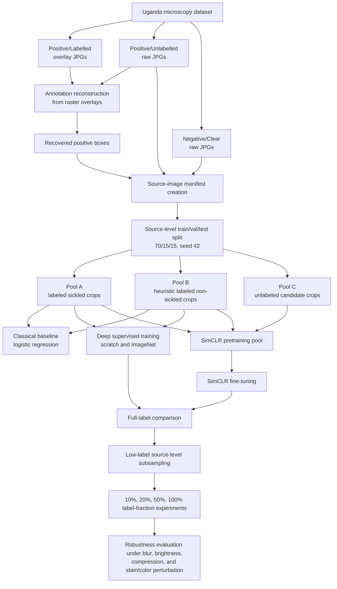

The repository also contains an exploratory grayscale branch, but the primary canonical pipeline in the workspace is the RGB branch summarized above.

## Cohort Assembly and Data Characterization

### Data Source and Acquisition

The experiments use the **Uganda Smartphone Microscopy Sickle Cell Dataset**:
- **Source:** [Kaggle - florencetushabe/sickle-cell-disease-dataset](https://www.kaggle.com/datasets/florencetushabe/sickle-cell-disease-dataset)
- **Principal Authors / Curators:** Prof. Florence Tushabe, Samuel Mwesige, Vicent Kasule, David Areu, Philip Mutabazi, Emily Nsimire, Sarah Cheptoek Musani, and Emmanuel Othieno (Soroti University, Uganda).
- **Clinical Origin:** Blood smear samples collected from Kumi Hospital, Soroti Regional Referral Hospital, and Soroti University in eastern Uganda. Samples were prepared with Field and Leishman stains and captured using smartphone cameras attached to standard compound light microscopes.
- **Repository Directory:** Placed under `./datasets/` (configured in `config.yaml`).

#### Automated Setup / Download
To download and verify the dataset into `./datasets/`:
```bash
# Requires kagglehub (pip install kagglehub)
python download_dataset.py
```
Or manually via the Kaggle CLI:
```bash
kaggle datasets download -d florencetushabe/sickle-cell-disease-dataset --unzip -p datasets/
```

> [!IMPORTANT]
> **Data Privacy and Version Control:**
> All raw images under `datasets/` and derived images (`datasets_masked_resized_1024/`) are explicitly excluded in `.gitignore` to ensure patient microscopy image files are never accidentally committed or tracked in Git.

### Expected Directory Layout and File Counts

- `datasets/Positive/Labelled/` (422 images): Smartphone micrographs with black rectangular box overlays indicating sickled cells.
- `datasets/Positive/Unlabelled/` (422 images): Matching raw smartphone micrographs without bounding box overlays.
- `datasets/Negative/Clear/` (147 images): Raw smartphone micrographs from negative/normal blood smears.
- **Total Scanned Files:** 991 images (569 unique source images for modeling).

### Image audit summary

All numerical values below are taken from the saved audit artifact `eda_outputs/stage1_data_audit.md`.

| Quantity | Value |
|---|---:|
| Positive raw images for modeling | 422 |
| Positive labelled overlay images | 422 |
| Negative clear images | 147 |
| Positive labelled/unlabelled filename pairs | 422 |
| Total image files scanned | 991 |
| Source images used downstream | 569 |

### Image size profile

| Statistic | Width | Height |
|---|---:|---:|
| Median | 1000 | 1009 |
| Minimum | 469 | 436 |
| Maximum | 4160 | 3440 |

### Quality and color-cast proxy summary

| Image quality category | Count |
|---|---:|
| usable | 565 |
| low_contrast | 4 |

| Color-cast proxy category | Count |
|---|---:|
| balanced_mixed_cast | 238 |
| blue_purple_cast | 120 |
| green_cyan_cast | 11 |
| pink_red_cast | 200 |

### Stain metadata status

No explicit stain labels were encoded in the raw folder or filename structure used by the current pipeline. As a result:

- split manifests retain stain as effectively `unknown`,
- stain-aware stratification was not meaningfully available,
- robustness conclusions are based on synthetic perturbations rather than known stain metadata.

## Annotation Reconstruction and Label Derivation

### Annotation storage reality

No separate XML, JSON, TXT, or coordinate annotation files were found. Instead, the positive annotations were embedded as black rectangle overlays in the labelled JPGs. Matching raw images were available in the corresponding unlabelled directory.

### Annotation reconstruction method

Positive crop annotations were reconstructed from the overlay/raw image pairs using an image-processing heuristic implemented in `eda.py`. The main logic was:

1. Resize the labelled and raw images to a common analysis grid.
2. Detect dark rectangular regions by paired differencing and single-image dark-region fallback logic.
3. Remove edge-connected regions and non-rectangular connected components.
4. Score recovered components for box-like geometry and interior occupancy.
5. Categorize components into `likely_crop_candidate`, `loose_or_empty`, or `overfilled`.

### Annotation reconstruction workflow

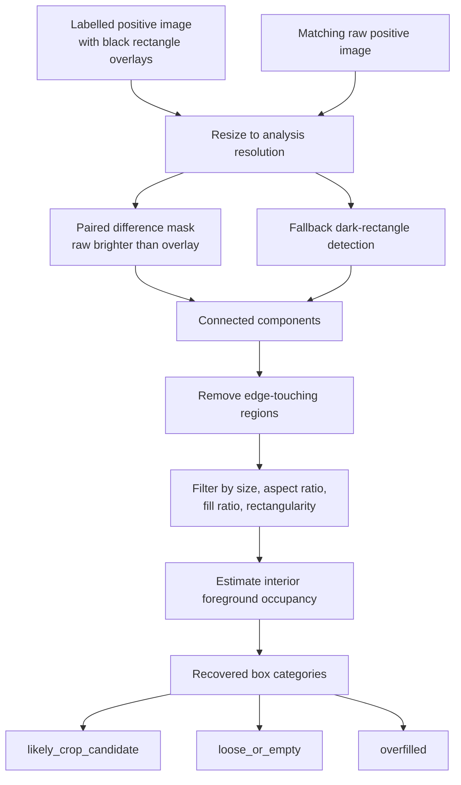

### Annotation reconstruction results

| Quantity | Value |
|---|---:|
| Labelled images with at least one detected box | 421 / 422 |
| Total detected boxes | 1408 |
| Likely crop-candidate boxes | 993 |
| Crop-candidate proportion | 70.5% |

| Recovered box quality bucket | Count |
|---|---:|
| likely_crop_candidate | 993 |
| loose_or_empty | 159 |
| overfilled | 256 |

### Scientific implication

The positive labels used downstream are usable for experimentation, but they are not equivalent to original gold-standard coordinate annotations. Any scientific interpretation must retain that limitation.

## Source-Level Partitioning and Leakage Control

To avoid train/test contamination through shared source-image style, illumination, or capture artifacts, the repository splits the data at the source-image level before crop generation. This policy is implemented in `split_protocol.py`.

### Partition design

- train / validation / test target: `70% / 15% / 15%`
- deterministic seed: `42`
- globally unique source keys were used to avoid positive/negative filename collisions

### Final source split

| Split | Sources | Positive | Negative |
|---|---:|---:|---:|
| train | 399 | 296 | 103 |
| val | 85 | 63 | 22 |
| test | 85 | 63 | 22 |
| total | 569 | 422 | 147 |

### Importance of this choice

This is one of the strongest design decisions in the repository. It prevents the common failure mode where train and test sets share crops from the same original microscopy frame.

## Crop Dataset Construction

Crop generation is implemented in `crop_creation.py`. The repository constructs three distinct pools with different purposes.

### Crop pool definitions

- **Pool A**: labeled sickled crops from recovered positive-image boxes
- **Pool B**: heuristic labeled non-sickled crops from negative images using connected components
- **Pool C**: unlabeled candidate crops for SimCLR pretraining

### Crop counts

| Pool | Definition | Total | Train | Val | Test |
|---|---|---:|---:|---:|---:|
| Pool A | labeled sickled | 1249 | 917 | 150 | 182 |
| Pool B | labeled non-sickled | 1462 | 1000 | 236 | 226 |
| Pool C | unlabeled candidate crops | 3971 | 2790 | 568 | 613 |

### Crop construction facts

| Quantity | Value |
|---|---:|
| Output crop size | 128 x 128 |
| Sources with multiple splits after crop generation | 0 |

### Quality caveat for Pool B

Pool B is not an expert-reviewed non-sickled cell set. It is a heuristic negative-crop pool derived from connected components in negative source images. Some crops include border or context artifacts, which is an important limitation.

### Representative crop-generation visual

*Figure 1. Pool B spot-check contact sheet illustrating heuristic non-sickled crop generation and its artifact risk.*

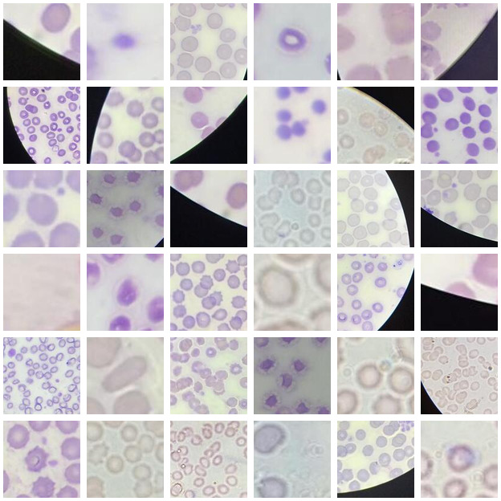

## Classical Discriminative Baseline

Before deep learning, the repository established a fast statistical baseline using logistic regression over handcrafted image features. This model is implemented in `train_binary_classifier.py`.

### Feature design

The feature representation combined:

- resized RGB thumbnail features,
- RGB histogram features,
- simple texture features,
- brightness statistics.

### Training data counts

| Split | Sickled | Non-sickled | Total |
|---|---:|---:|---:|
| train | 917 | 1000 | 1917 |
| val | 150 | 236 | 386 |
| test | 182 | 226 | 408 |

### Leakage checks

| Quantity | Value |
|---|---:|
| n_sources | 543 |
| sources_with_multiple_splits | 0 |
| sources_with_multiple_labels | 0 |

### Validation model selection

| Regularization C | Balanced Accuracy | Accuracy | Macro F1 | ROC AUC |
|---|---:|---:|---:|---:|
| 0.01 | 0.8083 | 0.8057 | 0.8000 | 0.8673 |
| 0.1 | 0.7780 | 0.7746 | 0.7688 | 0.8421 |
| 1.0 | 0.7495 | 0.7487 | 0.7418 | 0.8050 |
| 10.0 | 0.7335 | 0.7306 | 0.7243 | 0.7734 |

### Test performance

| Metric | Value |
|---|---:|
| Accuracy | 0.8505 |
| Balanced accuracy | 0.8485 |
| Macro F1 | 0.8486 |
| ROC AUC | 0.8988 |

### Test confusion matrix

| Actual class | Predicted non_sickled | Predicted sickled |
|---|---:|---:|
| non_sickled | 196 | 30 |
| sickled | 31 | 151 |

### Majority-class comparison

| Split | Majority-baseline accuracy | Majority-baseline balanced accuracy |
|---|---:|---:|
| val | 0.6114 | 0.5000 |
| test | 0.5539 | 0.5000 |

### Interpretation

The classical model established that the crop-level task is meaningfully learnable and clearly above a one-class baseline. However, it could not determine whether the learned signal was genuinely morphological or partly driven by extraction artifacts and capture shortcuts.

### Representative baseline visuals

*Figure 2. Test confusion matrix for the classical baseline.*

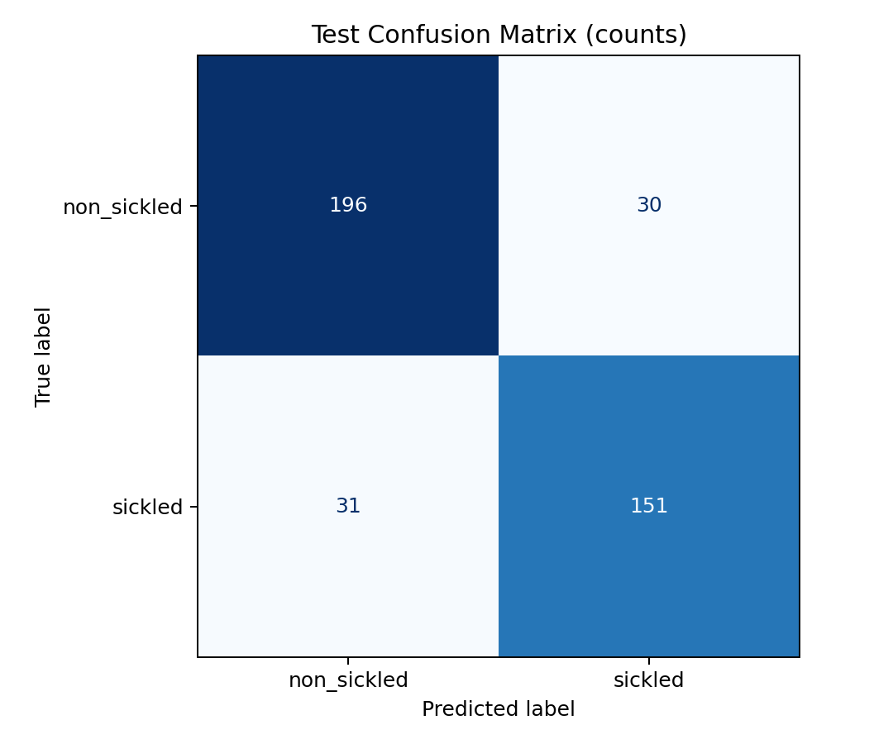

*Figure 3. ROC curve for the classical baseline.*

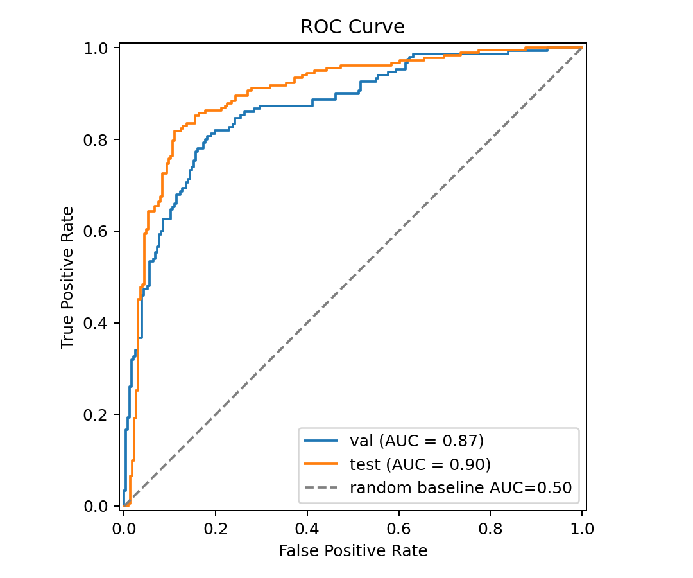

*Figure 4. Error contact sheet for qualitative inspection of baseline failures.*

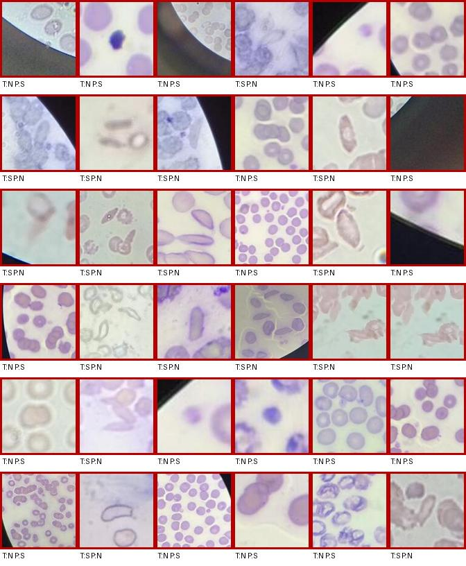

## Deep Convolutional Baselines and In-Domain Self-Supervised Pretraining

The core representation-learning comparison was implemented in `train_stage5.py`. Three branches were evaluated:

1. `supervised_scratch`
2. `imagenet_finetune`
3. `simclr_finetune`

### Supervised training configuration

| Parameter | Value |
|---|---:|
| Backbone | ResNet-18 |
| Image size | 224 |
| Batch size | 32 |
| Epochs | 20 |
| Optimizer | AdamW |
| Learning rate | 1e-4 |
| Weight decay | 1e-4 |
| Scheduler | Cosine annealing |
| Loss | class-weighted cross-entropy |

### Supervised augmentation policy

- resize to `224 x 224`
- random horizontal flip
- random vertical flip
- random rotation up to `180`
- modest color jitter

### SimCLR pretraining configuration

| Parameter | Value |
|---|---:|
| Backbone | ResNet-18 encoder |
| Projection head | linear -> ReLU -> linear |
| Projection dimension | 128 |
| Epochs | 50 |
| Batch size | 64 |
| Learning rate | 3e-4 |
| Weight decay | 1e-4 |
| Temperature | 0.2 |
| Scheduler | Cosine annealing |

### SimCLR augmentation policy

- random resized crop with scale `(0.55, 1.0)`
- random horizontal and vertical flips
- random rotation up to `180`
- stronger color jitter
- random grayscale with probability `0.10`
- Gaussian blur

### Effective unlabeled exposure for SimCLR

| Source contributing to SSL pool | Number of crops |
|---|---:|
| Pool C unlabeled train crops | 2790 |
| Pool A + Pool B train crops with labels removed | 1917 |
| Total train-split SSL pool | 4707 |

The SimCLR loss reportedly decreased from approximately `4.08` at epoch 1 to approximately `1.20` by epoch 50, indicating that the contrastive objective optimized as intended.

### Full-label RGB comparison

The canonical RGB comparison, taken from `stage5_outputs/stage5_report.md`, is shown below.

| Model family | Best validation balanced accuracy | Test crop balanced accuracy | Test crop ROC AUC | Test source balanced accuracy |
|---|---:|---:|---:|---:|
| supervised_scratch | 0.9343 | 0.9311 | 0.9854 | 0.9518 |
| imagenet_finetune | 0.9945 | 0.9863 | 0.9997 | 1.0000 |
| simclr_finetune | 0.9785 | 0.9851 | 0.9987 | 1.0000 |

### Interpretation

This comparison answers the primary representation-learning question clearly:

- deep learning substantially improves upon the classical baseline,
- in-domain SimCLR provides a large improvement over supervised training from scratch,
- ImageNet fine-tuning remains the strongest overall full-label baseline in the canonical RGB branch.

### Representative full-label model visual

*Figure 5. Aggregate comparison of the deep full-label baselines.*

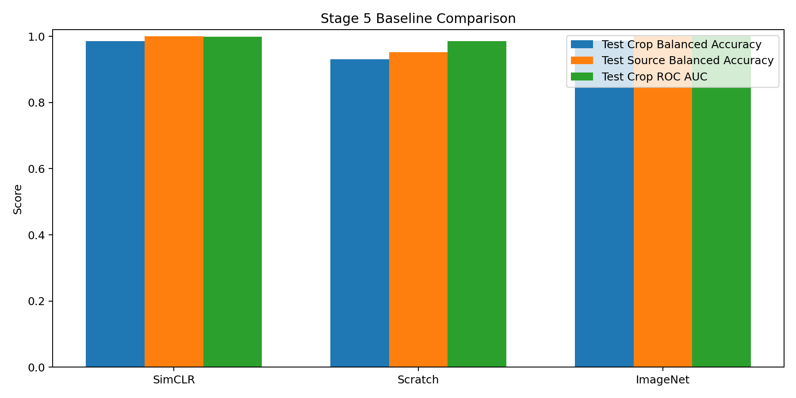

## Label-Efficiency Under Source-Level Subsampling

The low-label protocol was implemented in `train_stage6_low_label.py`. This experiment asked whether the value of self-supervised initialization increases when labeled supervision is scarce.

### Experimental design

- only the train split was subsampled,
- subsampling was done at the source-image level,
- validation and test sets remained fixed,
- subsets were nested and class-stratified,
- label fractions were `100%`, `50%`, `20%`, and `10%`.

### Training subset sizes

| Label fraction | Train sources | Train crops |
|---|---:|---:|
| 100% | 382 | 1917 |
| 50% | 190 | 900 |
| 20% | 76 | 367 |
| 10% | 38 | 196 |

### Low-label RGB results

| Label fraction | Scratch balanced accuracy | SimCLR balanced accuracy | ImageNet balanced accuracy | SimCLR minus scratch |
|---|---:|---:|---:|---:|
| 100% | 0.9311 | 0.9873 | 0.9863 | 0.0562 |
| 50% | 0.8388 | 0.9658 | 0.9895 | 0.1270 |
| 20% | 0.7745 | 0.9310 | 0.9724 | 0.1565 |
| 10% | 0.6844 | 0.8791 | 0.9305 | 0.1948 |

### Low-label RGB ROC AUC and source-level summary

| Label fraction | Setup | Test crop ROC AUC | Test source balanced accuracy |
|---|---|---:|---:|
| 100% | scratch | 0.9854 | 0.9518 |
| 100% | imagenet | 0.9997 | 1.0000 |
| 100% | simclr | 0.9989 | 1.0000 |
| 50% | scratch | 0.9239 | 0.8297 |
| 50% | imagenet | 0.9988 | 1.0000 |
| 50% | simclr | 0.9966 | 0.9688 |
| 20% | scratch | 0.8185 | 0.7704 |
| 20% | imagenet | 0.9966 | 0.9688 |
| 20% | simclr | 0.9864 | 0.9688 |
| 10% | scratch | 0.7740 | 0.7419 |
| 10% | imagenet | 0.9839 | 0.9831 |
| 10% | simclr | 0.9475 | 0.8810 |

### Interpretation

This is one of the strongest results in the repository. The gain of SimCLR over scratch increases monotonically as labels are reduced:

- `+0.0562` at full labels,
- `+0.1270` at 50% labels,
- `+0.1565` at 20% labels,
- `+0.1948` at 10% labels.

That pattern strongly supports the intended scientific hypothesis that in-domain self-supervised learning is especially useful in the low-label regime.

### Representative low-label visuals

*Figure 6. Test crop balanced accuracy across label fractions.*

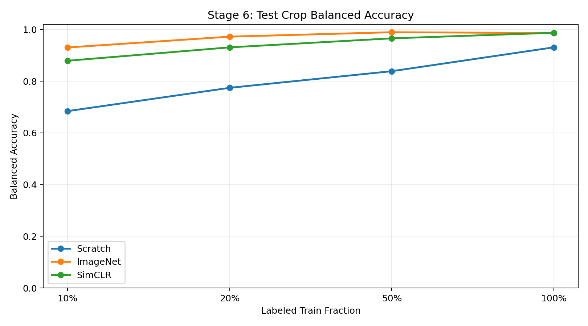

*Figure 7. Gain over scratch across label fractions.*


*Figure 8. Heatmap summary of the low-label comparison.*

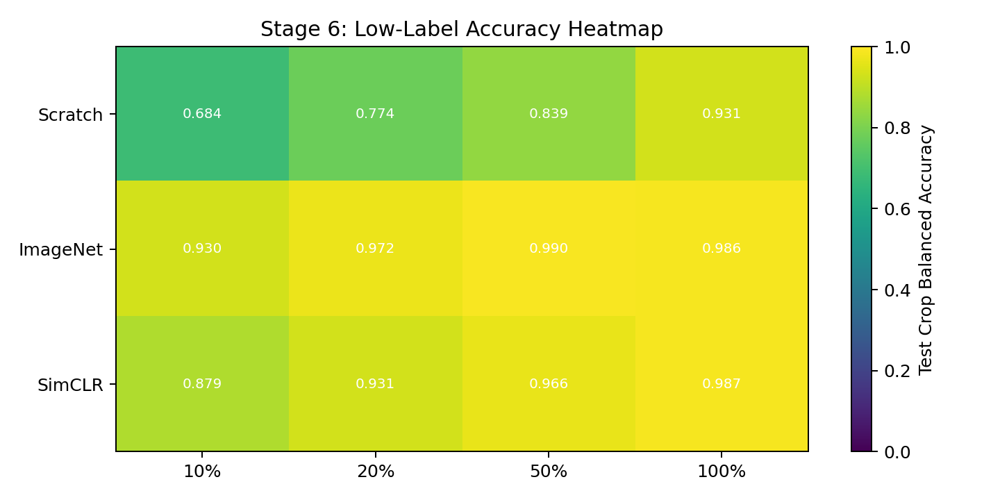

## Robustness Under Smartphone-Style Perturbations

The robustness study was implemented in `evaluate_stage7_robustness.py` and `evaluate_stage7_low_label_robustness.py`. These analyses test whether clean performance remains stable under mild deterministic perturbations intended to approximate common smartphone microscopy acquisition issues.

### Perturbation protocol

| Perturbation | Setting |
|---|---|
| blurred | Gaussian blur radius `1.25` |
| lower_brightness | brightness factor `0.75` |
| mild_compression | JPEG quality `45` |
| mild_stain_color | RGB scales `(1.08, 0.97, 1.06)` with color factor `1.08` and contrast factor `1.03` |

### Full-label RGB robustness

The table below evaluates the saved full-label RGB checkpoints.

| Model family | Clean | Blur | Brightness | Compression | Stain/Color | Largest drop from clean |
|---|---:|---:|---:|---:|---:|---|
| supervised_scratch | 0.9311 | 0.9261 | 0.8824 | 0.9090 | 0.5066 | stain/color |
| imagenet_finetune | 0.9863 | 0.9835 | 0.9808 | 0.9478 | 0.9635 | compression |
| simclr_finetune | 0.9851 | 0.9846 | 0.9785 | 0.9851 | 0.7212 | stain/color |

### Drop-from-clean summary

| Model family | Blur drop | Brightness drop | Compression drop | Stain/color drop |
|---|---:|---:|---:|---:|
| supervised_scratch | 0.0050 | 0.0487 | 0.0221 | 0.4245 |
| imagenet_finetune | 0.0027 | 0.0055 | 0.0385 | 0.0227 |
| simclr_finetune | 0.0005 | 0.0066 | 0.0000 | 0.2639 |

### Interpretation

The robustness analysis shows that:

- scratch is highly vulnerable to stain/color perturbation,
- SimCLR is much stronger than scratch overall, but still displays non-trivial RGB stain/color sensitivity,
- ImageNet is the most robust overall baseline in the current RGB experiments.

### Representative robustness visuals

*Figure 9. Full-label robustness drop from clean performance.*

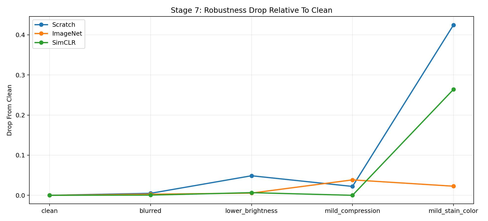

*Figure 10. Perturbation-wise balanced accuracy across model families.*

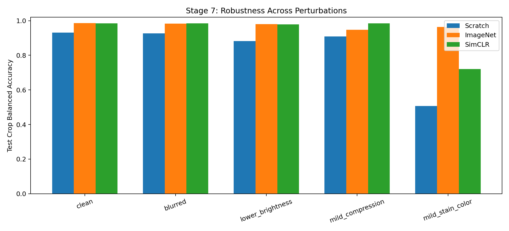

## Low-Label Robustness

The low-label robustness report is now complete in the saved RGB outputs and evaluates all four label fractions.

### Clean low-label performance under the robustness protocol

| Label fraction | Scratch clean | SimCLR clean | ImageNet clean | SimCLR minus scratch |
|---|---:|---:|---:|---:|
| 100% | 0.9311 | 0.9873 | 0.9863 | 0.0562 |
| 50% | 0.8388 | 0.9658 | 0.9895 | 0.1270 |
| 20% | 0.7745 | 0.9310 | 0.9724 | 0.1565 |
| 10% | 0.6844 | 0.8791 | 0.9305 | 0.1948 |

### Stain/color robustness under reduced supervision

| Label fraction | Scratch stain/color | SimCLR stain/color | ImageNet stain/color | SimCLR drop from clean |
|---|---:|---:|---:|---:|
| 100% | 0.5066 | 0.9226 | 0.9635 | 0.0648 |
| 50% | 0.5000 | 0.7212 | 0.9099 | 0.2446 |
| 20% | 0.5631 | 0.7423 | 0.9530 | 0.1887 |
| 10% | 0.5018 | 0.7711 | 0.9133 | 0.1080 |

### Interpretation

Under label scarcity:

- the SimCLR advantage over scratch persists under perturbation,
- scratch collapses badly under stain/color shifts,
- SimCLR remains clearly better than scratch, though still imperfect under stain/color perturbation,
- ImageNet remains the strongest and most stable baseline overall.

### Representative low-label robustness visuals

*Figure 11. Clean low-label robustness summary.*

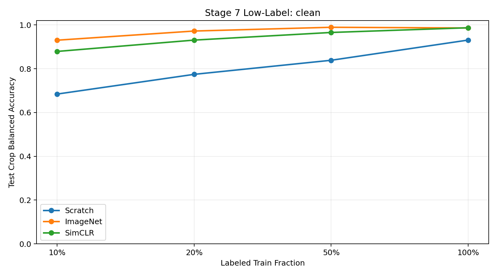

*Figure 12. SimCLR gain over scratch in the low-label clean regime.*

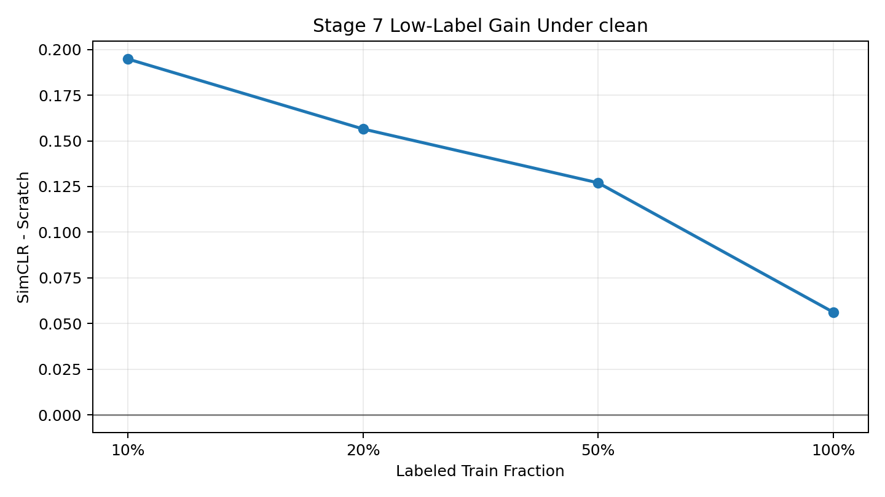

*Figure 13. Overall robustness snapshot combining the main saved RGB findings.*


## Exploratory Grayscale Extension

The current workspace contains an exploratory grayscale branch under:

- `stage5_grayscale_outputs/`
- `stage6_grayscale_outputs/`

These runs convert inputs to grayscale while preserving the 3-channel model interface. This branch is useful for testing whether the models rely primarily on color/stain cues or whether morphology remains predictive after color removal.

### Completed full-label grayscale comparison

The full-label grayscale comparison is available in `stage5_grayscale_outputs/stage5_report.md`.

| Model family | Test crop balanced accuracy | Test crop ROC AUC | Test source balanced accuracy |
|---|---:|---:|---:|
| supervised_scratch | 0.9403 | 0.9889 | 0.9688 |
| imagenet_finetune | 0.9950 | 0.9999 | 1.0000 |
| simclr_finetune | 0.9928 | 0.9995 | 1.0000 |

### Saved low-label grayscale results

The current workspace contains saved low-label grayscale runs for all four fractions:

| Label fraction | Scratch balanced accuracy | SimCLR balanced accuracy | ImageNet balanced accuracy | SimCLR minus scratch |
|---|---:|---:|---:|---:|
| 100% | 0.9403 | 0.9928 | 0.9950 | 0.0525 |
| 50% | 0.8405 | 0.9834 | 0.9868 | 0.1429 |
| 20% | 0.7570 | 0.9718 | 0.9531 | 0.2149 |
| 10% | 0.6419 | 0.9188 | 0.9631 | 0.2769 |

### Interpretation

The grayscale branch suggests that:

- performance does not collapse when color is removed,
- strong morphology signal remains available,
- the low-label SimCLR advantage is not obviously dependent on RGB color alone,
- stain/color fragility is greatly reduced once the pipeline is rerun in grayscale.

## XAI And Shortcut Diagnostics

The repository contains an explicit interpretability pipeline under:

- `interpretability_outputs/stage5_rgb/`
- `interpretability_outputs/stage5_grayscale/`

For each selected sample and each setup, the XAI pipeline generates:

1. `Grad-CAM`
2. `Occlusion`
3. `Nearest neighbors`
4. `Perturbation grids`
5. `Shortcut-sensitivity plots`

These are useful for answering a narrower question than the aggregate metrics:

**When SimCLR succeeds or fails on an individual crop, does it appear to rely on cell morphology, or is it reacting to nuisance cues such as stain/color, field edges, brightness, or context?**

### How to read the XAI visuals

- `Grad-CAM` highlights the spatial regions that most support the predicted class.
- `Occlusion` shows where masking a local region most reduces predicted-class confidence.
- `Nearest neighbors` show which training crops are closest in the learned feature space.
- `Shortcut-sensitivity` plots show predicted `P[sickled]` under `clean`, `forced_grayscale`, `blurred`, `lower_brightness`, `mild_compression`, and `mild_stain_color`.

The interpretive rule used in this repo is:

- if saliency and occlusion focus mainly on cells and stay stable under nuisance perturbations, that supports morphology use,
- if saliency spreads into borders/background and confidence flips strongly under color-related perturbations, that suggests shortcut use.

### Representative XAI failure case: `A__positive_20__0009`

This sample is actually `sickled`, but the RGB SimCLR model predicts `non_sickled` with `P[sickled]=0.0245`.

*Figure 14. RGB SimCLR Grad-CAM on the failure case `A__positive_20__0009`.*


*Figure 15. RGB SimCLR occlusion map on the same failure case.*


*Figure 16. RGB SimCLR nearest-neighbor retrievals for the same failure case.*

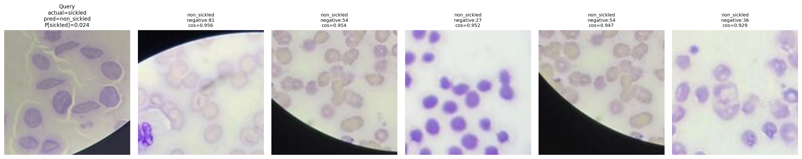

*Figure 17. RGB shortcut-sensitivity plot for `A__positive_20__0009`.*

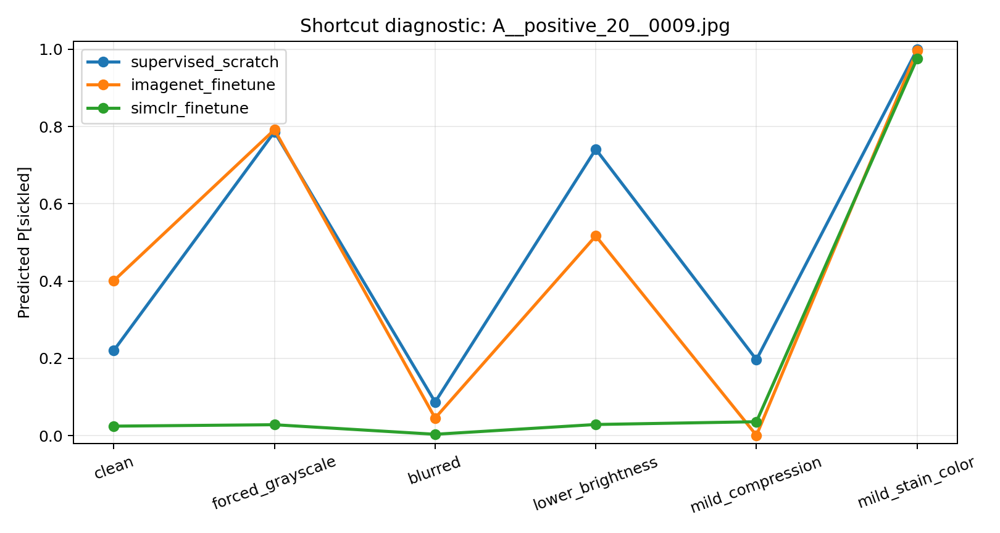

Observed pattern:

- the Grad-CAM hotspot is broad and extends into the lower-left field-edge region rather than isolating only the elongated cells,
- the occlusion map also emphasizes a broad center-lower region instead of one clearly diagnostic sickled cell,
- the retrieved neighbors are non-sickled examples with similar pale background and field-edge appearance,
- the shortcut-sensitivity curve is extremely unstable:
  - clean: about `0.024`
  - forced grayscale: about `0.028`
  - blur/compression: still near zero
  - mild stain/color: jumps to nearly `0.98`

Interpretation:

- this is strong sample-level evidence that RGB SimCLR is using nuisance appearance cues,
- the near-complete class reversal under `mild_stain_color` is not what a morphology-only rule would be expected to do,
- this case supports the claim that SimCLR may be partially "cheating" in the RGB branch.

### Representative XAI ambiguity case: `B__negative_37__0012`

This sample is actually `non_sickled`. In RGB, the SimCLR branch predicts `non_sickled` with only moderate separation and shows large perturbation sensitivity.

*Figure 18. RGB shortcut-sensitivity plot for `B__negative_37__0012`.*

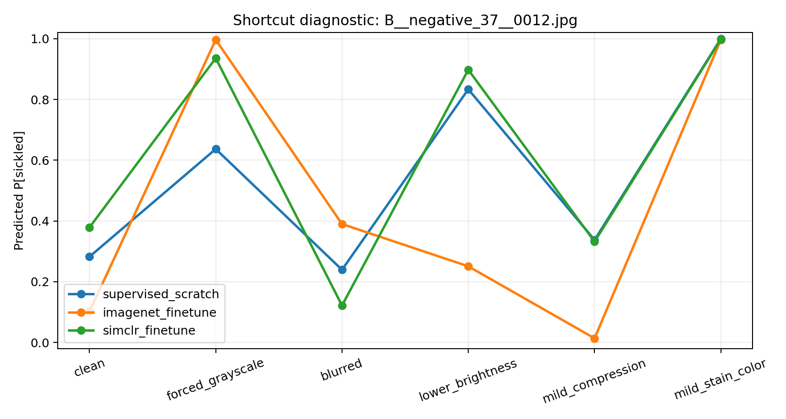

*Figure 19. Grayscale shortcut-sensitivity plot for the same sample.*

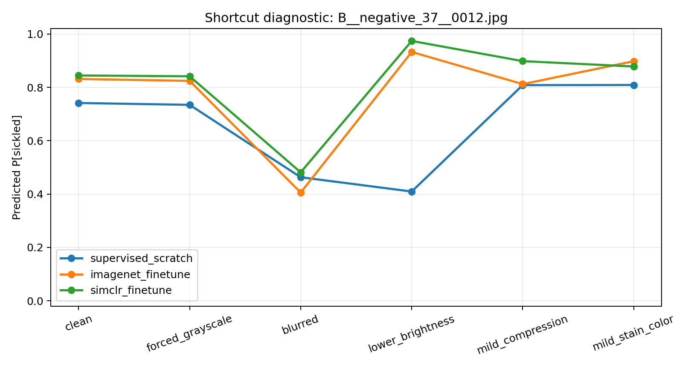

Observed pattern:

- in RGB, the prediction changes sharply under grayscale conversion, brightness change, and stain/color perturbation,
- in grayscale, the same sample remains much flatter and more stable across perturbations,
- this matches the repo-wide robustness finding that the RGB branch carries stain/color dependence while the grayscale branch removes most of it.

### XAI conclusion

The XAI outputs do **not** support the strongest claim that SimCLR is only cheating. They support a narrower and more defensible claim:

**The RGB SimCLR branch appears to use a mixture of real morphology signal and nuisance visual cues. On several informative failure or ambiguity cases, the visuals support partial shortcut reliance, especially on stain/color-sensitive samples.**

## Integrated Scientific Findings

### What is convincingly demonstrated

1. The Uganda smartphone microscopy data can support a meaningful crop-level binary morphology task.
2. Source-level splitting was enforced correctly and avoids a major leakage failure mode.
3. The crop-generation pipeline produces enough signal to support both classical and deep-learning baselines.
4. In-domain SimCLR materially improves over supervised training from scratch.
5. The benefit of SimCLR grows as the amount of labeled data decreases.
6. ImageNet fine-tuning remains the strongest overall baseline in the canonical RGB branch.
7. Stain/color sensitivity remains the dominant weakness in RGB robustness, especially for scratch and, to a lesser extent, SimCLR.
8. The XAI outputs support partial shortcut reliance in the RGB SimCLR branch, but not a pure-shortcut explanation.

### Best-performing canonical RGB configurations

| Evaluation context | Best model family | Test crop balanced accuracy |
|---|---|---:|
| full-label comparison | imagenet_finetune | 0.9863 |
| low-label 50% | imagenet_finetune | 0.9895 |
| low-label 20% | imagenet_finetune | 0.9724 |
| low-label 10% | imagenet_finetune | 0.9305 |

### Best evidence that SimCLR is scientifically useful

| Condition | Evidence |
|---|---|
| Full-label RGB | SimCLR `0.9851` vs scratch `0.9311` |
| 50% labels RGB | SimCLR `0.9658` vs scratch `0.8388` |
| 20% labels RGB | SimCLR `0.9310` vs scratch `0.7745` |
| 10% labels RGB | SimCLR `0.8791` vs scratch `0.6844` |

### Best evidence of remaining shortcut risk

| Condition | Evidence |
|---|---|
| Full-label scratch stain/color drop | `0.4245` |
| Full-label SimCLR stain/color drop | `0.2639` |
| 50% low-label SimCLR stain/color drop | `0.2446` |
| Pool B construction | heuristic negative-crop generation, not expert-cleaned labels |
| XAI failure case `A__positive_20__0009` | RGB SimCLR flips from about `0.024` clean to near `0.98` under mild stain/color perturbation |

## Study Limitations

The current repository supports strong methodological conclusions, but several caveats remain essential:

1. Pool B non-sickled crops are heuristic labels rather than cell-by-cell expert annotations.
2. Positive boxes were reconstructed from raster overlays rather than original coordinate files.
3. Real stain metadata is not present in the current manifests.
4. Robustness results are synthetic perturbation tests, not external hospital or device transfer studies.
5. The XAI analysis is qualitative and based on a small representative sample set rather than a large-scale attribution benchmark.

## Final Conclusion

The repository has successfully built a complete crop-level sickle-cell morphology pipeline from raw Uganda smartphone microscopy data through robust downstream evaluation. The most defensible scientific conclusion is:

**In-domain self-supervised learning is clearly useful in this pipeline, especially when labeled data are limited, but ImageNet fine-tuning remains the strongest overall RGB baseline, and the combined robustness-plus-XAI evidence indicates that the RGB SimCLR branch still relies partly on stain/color/context shortcuts.**

## Primary Artifact Map

The most important files for inspection and reuse are:

- `eda_outputs/stage1_data_audit.md`
- `split_outputs/stage2_split_protocol.md`
- `crop_outputs/stage3_crop_creation.md`
- `stage4_outputs/stage4_binary_classifier.md`
- `stage5_outputs/stage5_report.md`
- `stage6_outputs/stage6_report.md`
- `stage7_outputs/stage7_report.md`
- `stage7_low_label_outputs/stage7_low_label_report.md`
- `visual_reports/stage5_stage6_stage7/visual_summary.md`
- `docs/COMPLETE_SCIENTIFIC_REPORT.md`
