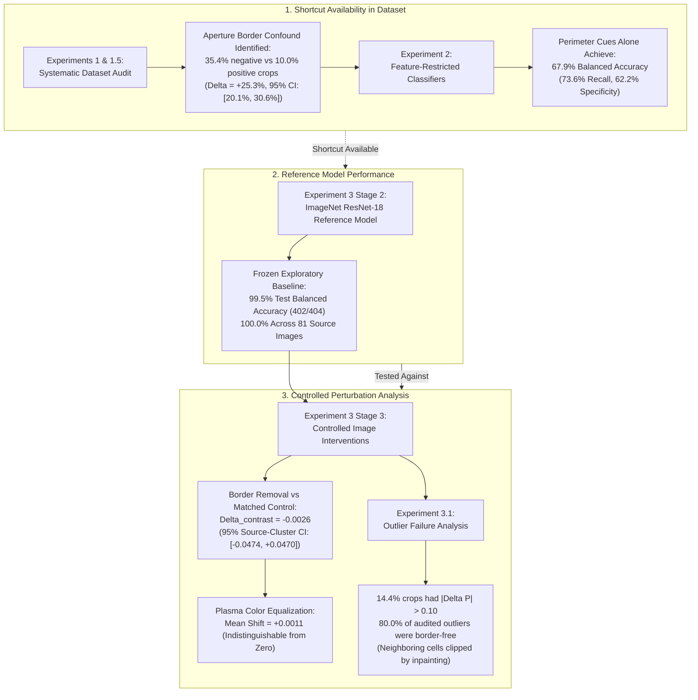
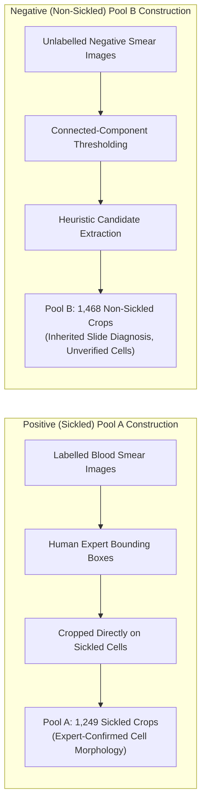
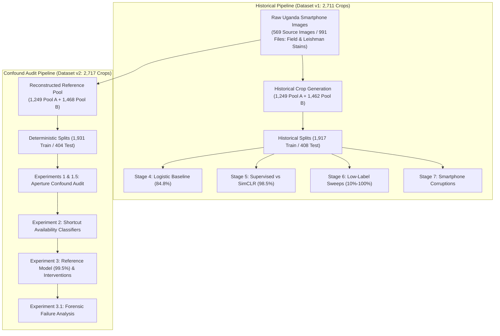

# Shortcut Availability Versus Model Sensitivity: An Exploratory Audit of Smartphone Sickle-Cell Microscopy Classification

[](https://www.python.org/)
[](https://pytorch.org/)
[]()
[](LICENSE)
[]()

> **Lead Researcher**: Shubhdeep Das  
> **Technical Assistant**: Antigravity AI Coding Assistant  
> **Repository**: `https://github.com/Shubhdeepdsa/sickel_cell_ssl`  
> **Primary Technical Manuscript**: [**`RESEARCH_MANUSCRIPT.md`**](RESEARCH_MANUSCRIPT.md)  
> **Active Branch**: `main` (synchronized with `experiment-3-reference-model`)  

---

## Table of Contents
1. [Research Overview & Core Scientific Contribution](#1-research-overview--core-scientific-contribution)
2. [Methodological Caveats & Boundaries](#2-methodological-caveats--boundaries)
3. [Cell-Label Validity & Asymmetric Crop Construction](#3-cell-label-validity--asymmetric-crop-construction)
4. [End-to-End Pipeline Architecture & Dataset Versioning](#4-end-to-end-pipeline-architecture--dataset-versioning)
5. [Discovery of the Aperture-Border Confound (Experiments 1 & 1.5)](#5-discovery-of-the-aperture-border-confound-experiments-1--15)
6. [Shortcut Availability Analysis (Experiment 2)](#6-shortcut-availability-analysis-experiment-2)
7. [Historical Representation Learning Benchmark (Dataset v1, Stages 4–7)](#7-historical-representation-learning-benchmark-dataset-v1-stages-47)
8. [Controlled Perturbation & Sensitivity Analysis (Dataset v2, Experiment 3)](#8-controlled-perturbation--sensitivity-analysis-dataset-v2-experiment-3)
9. [Forensic Failure Analysis & Adjudicated Visual Taxonomy (Experiment 3.1)](#9-forensic-failure-analysis--adjudicated-visual-taxonomy-experiment-31)
10. [Standalone Reproduction Guide](#10-standalone-reproduction-guide)
11. [Data Protection, Governance & Scholarly References](#11-data-protection-governance--scholarly-references)

---

## 1. Research Overview & Core Scientific Contribution

Automated classification of sickle-cell erythrocyte morphology from smartphone-mounted optical microscopy holds significant promise for point-of-care screening in resource-constrained clinics. However, deep neural networks applied to medical imaging are notoriously vulnerable to *shortcut learning*—exploiting non-biological imaging artifacts (such as microscope vignetting, staining protocol differences, or illumination boundaries) that happen to correlate with diagnostic labels in a specific cohort.

Earlier iterations of this project achieved remarkable test accuracies exceeding 98–99% using convolutional backbones and self-supervised SimCLR representations. To evaluate whether these scores reflected genuine cellular morphology or unintended imaging shortcuts, we conducted an end-to-end experimental audit.

### The Central Three-Part Scientific Finding



The investigation addresses three questions often conflated in clinical AI literature:
1. **Does the dataset contain an unintended shortcut?**  
   **Yes.** Non-sickled crops disproportionately sample peripheral slide coordinates, containing dark microscope aperture borders in **35.4%** of crops compared to only **10.0%** of sickled crops (difference: **25.3 percentage points**, 95% source-cluster bootstrap CI: $[20.1\%, 30.6\%]$).
2. **Can a classifier exploit that shortcut?**  
   **Yes.** Restricted-feature classifiers trained strictly on the outer 15% crop margin achieve **67.9% balanced accuracy** (and **79.9%** at the source-image level under default threshold), well above chance, without examining the central erythrocyte.
3. **Did the trained reference model depend on that shortcut?**  
   **The interventions did not establish substantial differential dependence on the tested aperture border on average.** Removing borders from border-bearing crops produced a mean probability shift ($+0.045$) virtually identical to matched control edits on clean crops ($+0.047$), yielding a net contrast of $\Delta_{\text{contrast}} = -0.0026$ (95% CI: $[-0.0474, +0.0470]$). However, individual predictions exhibited sensitivity to general peripheral image modifications (14.4% of negatives with $|\Delta P| > 0.10$, predominantly due to peripheral cell clipping).

### Executive Summary of Key Quantitative Findings

| Experimental Stage | Core Hypothesis Tested | Key Metric | 95% Source-Cluster CI | Scientific Interpretation |
|---|---|:---:|:---:|---|
| **Exp 1.5 Dataset Audit** | Aperture borders are evenly distributed | $\Delta = +25.3\%$ border rate | $[+20.1\%, +30.6\%]$ | **Hypothesis rejected**: Border artifact is strongly class-asymmetric (35.4% vs 10.0%). |
| **Exp 2 Tier 1A (Rule)** | Border presence predicts sickle label | **61.9%** Balanced Acc | $[55.7\%, 68.5\%]$ | Simple heuristic rule yields 92.3% sickled recall and 31.5% specificity. |
| **Exp 2 Tier 1B (Logistic)** | Border probability predicts sickle label | **61.9%** Balanced Acc | $[55.7\%, 68.5\%]$ | Univariate model yields 73.3% source-level acc ($th=0.50$) and 50.0% ($th^*=0.22$). |
| **Exp 2 Tier 2 (Perimeter)** | Margin features alone are predictive | **67.9%** Balanced Acc | $[60.7\%, 75.1\%]$ | Outer 15% edge statistics predict class (79.9% source-level acc) without center cell. |
| **Exp 3 Stage 2 (Reference)** | Baseline model achieves high accuracy | **99.5%** Balanced Acc | $[98.8\%, 100.0\%]$ | 402 of 404 test crops and 81 of 81 source images classified correctly under frozen protocol. |
| **Exp 3 Stage 3 (Intervention)** | Model differentially relies on border | $\Delta_{\text{contrast}} = -0.0026$ | $[-0.0474, +0.0470]$ | **No differential border reliance detected on average**; confidence interval spans zero. |
| **Exp 3.1 Visual Audit** | Outlier shifts driven by border loss | 16 / 20 outliers border-free | N/A (Descriptive) | **80% of top outliers had no border**; shifts driven by inpainting severing adjacent cells (45%). |

> [!IMPORTANT]
> **Core Conceptual Contribution**:  
> A predictive shortcut can exist in a dataset without being essential to every deep neural network trained on that dataset. Demonstrating that a shortcut is *available* does not prove that a high-performing model *relies* on it. Conversely, limited sensitivity to an isolated border edit does *not* prove exclusive reliance on biological morphology, because other unmeasured acquisition characteristics and contextual features remain untested.

---

## 2. Methodological Caveats & Boundaries

To ensure rigorous interpretation, four methodological boundaries must be kept in view:

1. **Source-Image Independence vs. Patient-Level & Smear-Level Validation**:  
   Partitions enforce strict source-image identifier separation (no crops from the same image file appear in both training and testing). However, as reported in the original dataset publication (Tushabe et al., 2024), the 569 source images originated from approximately 140 blood samples across two staining preparations (Field and Leishman) with multiple fields of view photographed per smear. Furthermore, Field stain accounts for approximately 43% of positive images versus 62% of negative images. Therefore, while source-image identifier overlap is eliminated, biological independence at the patient, smear, and staining levels remains unverified due to metadata limitations in the public release.
2. **Exploratory Protocol Status**:  
   The reference ResNet-18 model was evaluated once under a frozen protocol on the test partition. However, this test partition had been observed during earlier exploratory iterations of the research. These results represent a frozen benchmark on an exploratory cohort, not a prospective external validation study.
3. **Controlled Perturbation vs. Causal Isolation**:  
   Synthetic perimeter replacement ($T_{\text{border}}$ and $T_{\text{control}}$) assesses model sensitivity to peripheral pixel modifications. In biological microscopy, peripheral regions contain both non-biological background artifacts (illumination drop-off, aperture edges) and adjacent cellular material (neighboring erythrocytes). Therefore, perimeter edits perturb context as well as artifacts.
4. **No Clinical Diagnostic Deployment**:  
   This repository is an academic reliability audit investigating shortcut vulnerability and evaluation methodology. It is not approved medical software and must not be used for clinical decision-making.

---

## 3. Cell-Label Validity & Asymmetric Crop Construction

A critical methodological finding of this investigation concerns the fundamental asymmetry in how positive and negative training crops were originally constructed:



### The Annotation Asymmetry
- **Positive Crops (Pool A)**: Derived from human annotations where bounding boxes were manually drawn around verified sickled red blood cells.
- **Negative Crops (Pool B)**: Generated via heuristic connected-component detection on slides designated as "negative/clear." Individual crops inherited the whole-slide diagnostic label without per-cell expert validation.

### Empirical Evidence: Low Sickled Probabilities on Empty Plasma Crops
During the forensic audit of large prediction shifts (Experiment 3.1), two negative test crops were discovered to contain **no cellular body whatsoever**:
- `pool_b_116_cand11` (Source: `negative:116`): The crop consists of completely empty background plasma. Despite the total absence of erythrocyte morphology, the reference model assigned a very low baseline sickled probability of $P \approx 0.00002$. When the perimeter was modified, the prediction shifted to $P = 0.98972$ ($\Delta P = +0.98970$).
- `pool_b_122_cand04` (Source: `negative:122`): A second empty plasma crop received a baseline sickled probability of $P \approx 0.00003$, shifting to $P = 0.30593$ ($\Delta P = +0.30591$) under perimeter intervention.

### Scientific Implication
Two crops visually adjudicated as lacking identifiable erythrocyte bodies were nevertheless assigned very low sickled probabilities. These observations raise concerns that source-derived labels may reward predictions without requiring the intended cellular morphology. The predictive cues responsible remain unidentified.

> [!CAUTION]
> **Key Limitation**:  
> High classification accuracy (99.5%) on this dataset measures alignment with source-image diagnostic labels. It does **not** demonstrate expert-validated cellular morphological recognition.

---

## 4. End-to-End Pipeline Architecture & Dataset Versioning

To avoid the common pitfall of comparing models across incompatible data pools, this repository explicitly distinguishes between two versions of the dataset:

| Dataset Dimension | Dataset v1 (Historical Exploratory Pool) | Dataset v2 (Reconstructed Audit Reference Pool) |
|---|:---:|:---:|
| **Pipeline Stage Used** | Historical Stages 3–7 (SimCLR, Scratch, Transfer) | Experiments 1, 1.5, 2, 3, and 3.1 |
| **Total Crops** | **2,711 crops** | **2,717 crops** |
| **Sickled Crops (Pool A)** | 1,249 crops | 1,249 crops |
| **Non-Sickled Crops (Pool B)** | 1,462 crops | 1,468 crops (+6 candidates) |
| **Training Partition** | 1,917 crops | 1,931 crops |
| **Validation Partition** | 386 crops | 382 crops |
| **Test Partition** | 408 crops | 404 crops |
| **Source-Image Split Integrity** | Strict source-separated (81 test files) | Strict source-separated (81 test files, zero leakage) |

*Variance Explanation*: The 6-crop discrepancy in Pool B (1,462 in Dataset v1 vs 1,468 in Dataset v2) is associated with implementation differences between the historical pipeline (which used custom connected-component extraction and ImageMagick filtering) and the reconstructed reference pipeline (which used pure-Python Pillow-based preprocessing). The candidate boundary selection differences have not been mapped at the individual crop level.



---

## 5. Discovery of the Aperture-Border Confound (Experiments 1 & 1.5)

During systematic auditing, visual inspection revealed that crops extracted from negative slides frequently contained dark circular arcs along their margins, corresponding to the microscope optical field stop. In Experiments 1 and 1.5, an automated edge-luminance annular gradient detector was executed across all 2,717 reconstructed crops.

### The Macroscopic Asymmetry
- **Pool A (Sickled Crops)**: **10.0%** (125 of 1,249 crops flagged, 95% CI: $[8.3\%, 11.8\%]$).
- **Pool B (Non-Sickled Crops)**: **35.4%** (519 of 1,468 crops flagged, 95% CI: $[30.5\%, 40.2\%]$).
- **Systematic Disparity**: A class difference of **25.3 percentage points** (95% source-cluster bootstrap CI: $[20.1\%, 30.6\%]$).

Negative candidate generation disproportionately sampled peripheral coordinates near the microscope field stop. Consequently, an algorithm could partially distinguish classes merely by detecting this boundary artifact.

---

## 6. Shortcut Availability Analysis (Experiment 2)

Experiment 2 tested whether shallow classifiers restricted strictly to non-central image characteristics could predict diagnostic labels without inspecting the central erythrocyte:

| Evaluation Tier | Feature Description | Model & Regularization | Test Balanced Accuracy | 95% Source-Cluster CI | Sickled Recall (TPR) | Non-Sickled Spec (TNR) | Source-Level Acc ($th=0.50$) | Source-Level Acc ($th=th^*$) |
|---|---|---|:---:|:---:|:---:|:---:|:---:|:---:|
| **Tier 1A: Border-Only Rule** | Simple binary border indicator | Decision rule ($P \ge 0.50 \to \text{neg}$) | **61.9%** | [55.7%, 68.5%] | **92.3%** (168/182) | **31.5%** (70/222) | — | — |
| **Tier 1B: Border Logistic** | Univariate border probability | Logistic Regression ($th^*=0.22$) | **61.9%** | [55.7%, 68.5%] | **92.3%** (168/182) | **31.5%** (70/222) | **73.3%** | **50.0%** ($th^*=0.22$) |
| **Tier 2: Perimeter Classifier** | 12 edge statistics (RGB, luma, gradients) | Regularized Logistic ($C=1.0, th^*=0.51$) | **67.9%** | [60.7%, 75.1%] | **73.6%** (134/182) | **62.2%** (138/222) | **79.9%** | **79.6%** ($th^*=0.51$) |
| **Tier 3: Estimated Background** | Masked extracellular plasma statistics | Regularized Logistic ($C=10.0, th^*=0.55$) | **64.1%** | [57.8%, 70.3%] | 36.8% (67/182) | 91.4% (203/222) | **70.0%** | **67.2%** ($th^*=0.55$) |

> [!NOTE]
> **Perimeter Feature Content & Decision Thresholds**:  
> The outer 15% margin captures microscope aperture vignetting as well as peripheral erythrocyte packing geometry (neighboring cells grazing the crop boundary). In Tier 1B, 2, and 3, source-level accuracies are reported under both default ($th=0.50$) and validation-tuned thresholds ($th=th^*$). Tier 2 demonstrates that peripheral image information is highly predictive, but that information is not exclusively non-morphological.

---

## 7. Historical Representation Learning Benchmark (Dataset v1, Stages 4–7)

Prior to the artifact audit, the project investigated self-supervised representation learning on Dataset v1 (2,711 crops: 1,917 train, 408 test):

| Model Family | Pretraining Scheme | Training Crops | Test Balanced Accuracy | Test Raw Accuracy | Test ROC AUC |
|---|---|:---:|:---:|:---:|:---:|
| **Classical Logistic** | Pixel Flattening + L2 | 1,917 | **84.8%** | **85.0%** | **0.899** |
| **ResNet-18 (Scratch)** | Random initialization | 1,917 | 93.1% | 93.3% | 0.981 |
| **ResNet-18 (SimCLR)** | In-domain contrastive pretraining | 1,917 | 98.5% | 98.5% | 0.998 |
| **ResNet-18 (ImageNet)** | Torchvision ImageNet-1K | 1,917 | **98.6%** | **98.8%** | **0.999** |

### Key Historical Observations
1. **Low-Label Regimes (Stage 6)**: When downstream diagnostic labels were restricted during fine-tuning, in-domain SimCLR demonstrated substantial gains over training from scratch (+5.3% at 100% labels $\to$ **+27.7% at 10% labels on grayscale** [91.9% vs 64.2%]; **+19.5% on RGB** [87.9% vs 68.4%]). Note that the SSL pretraining pool included crops that were already localized via bounding boxes, so this measures downstream label efficiency rather than a 90% reduction in localization annotation effort. Furthermore, ImageNet transfer learning remained the strongest overall baseline across all label regimes (achieving 96.3% on grayscale with 10% labels).
2. **Perturbation Robustness (Stage 7)**: Models showed resilience against Gaussian blur and JPEG compression, but exhibited acute sensitivity to chromatic stain shifts.
3. **Attribution Artifacts**: Saliency analysis (Grad-CAM and occlusion sensitivity) revealed attribution hotspots extending into background plasma, prompting the subsequent confound audit.

---

## 8. Controlled Perturbation & Sensitivity Analysis (Dataset v2, Experiment 3)

To test whether a high-performing deep network demonstrably relies on the aperture-border shortcut, an ImageNet-pretrained ResNet-18 reference model was trained and evaluated under a **frozen exploratory protocol** on Dataset v2.

### Baseline Reference Model Performance
- **Checkpoint**: `experiment_3_reference_outputs/best_model.pt` (Epoch 13, SHA-256: `83cd725076f60899bea0dfe4b7bbaa729ff82a60293b4e799d3082a6ae0419bb`).
- **Crop-Level Test Performance**: **99.5% Balanced Accuracy** (402 of 404 correct crops; 181/182 sickled recall, 221/222 non-sickled specificity, ROC AUC = 0.9997).
- **Source-Level Test Performance**: **100.0% Accuracy** across all 81 source files.

### Subgroup Stratification on Natural, Unmodified Crops
| Subgroup Stratum | Number of Crops | Reference Model Accuracy | Mean $P(\text{Sickled})$ | Std Dev |
|---|---:|---:|---:|---:|
| **Sickled (Clean / No Border)** | 168 | **99.4%** | 0.994 | 0.075 |
| **Sickled (Border Present)** | 14 | **100.0%** | 0.996 | 0.012 |
| **Non-Sickled (Clean / No Border)** | 152 | **99.3%** | 0.013 | 0.063 |
| **Non-Sickled (Border Present)** | 70 | **100.0%** | 0.003 | 0.023 |

**Key Finding**: On the 152 natural non-sickled test crops with **zero detected aperture border**, the model achieved **99.3% accuracy** (151/152 correct) with a mean predicted sickled probability of only **0.013**. The aperture border is clearly not required for the classifier to predict non-sickled status.

### Controlled Perimeter Inpainting ($T_{\text{border}}$ vs $T_{\text{control}}$)
The outer 15% margin (19 pixels) was replaced with local background color using a Gaussian-smoothed edge blend, comparing border-bearing non-sickled crops ($T_{\text{border}}$) against an identical edit on clean non-sickled crops ($T_{\text{control}}$):

$$\Delta_{\text{contrast}} = \mathbb{E}[\Delta P \mid \text{Border}] - \mathbb{E}[\Delta P \mid \text{Clean}] = \mathbf{-0.0026}$$
$$95\% \text{ Source-Cluster Bootstrap CI} = \mathbf{[-0.0474, +0.0470]}$$

$$\Delta_{|\text{contrast}|} = \mathbb{E}[|\Delta P| \mid \text{Border}] - \mathbb{E}[|\Delta P| \mid \text{Clean}] = \mathbf{-0.0173}$$
$$95\% \text{ Source-Cluster Bootstrap CI} = \mathbf{[-0.0640, +0.0339]}$$

> [!NOTE]
> **Interpretation as an Uncertainty Bound**:  
> The contrast is near zero and the 95% bootstrap interval spans zero, demonstrating that the study did not detect a clear differential response between the two groups. Because the interval admits modest differences of up to $\pm 0.05$, this represents an **absence of detected difference rather than proven mathematical equivalence**.

### Background Plasma Equalization
Multiplicatively rescaling RGB channels to match the empirical training-set median background shifted test predictions by a negligible $+0.0011$ (mean $|\Delta P| = 0.0048$, 95% CI: $[-0.001, +0.004]$).

---

## 9. Forensic Failure Analysis & Adjudicated Visual Taxonomy (Experiment 3.1)

While the signed average shift was modest (+0.045), examining absolute probability shifts ($|\Delta P|$) revealed meaningful individual sensitivity:
- **Median $|\Delta P|$**: 0.0000 (over 75% of crops had $|\Delta P| \le 0.0005$).
- **Crops with $|\Delta P| > 0.10$**: **14.4%** (32 of 222 non-sickled crops).
  - Border-Bearing Negatives: **14.3%** (10 of 70)
  - Border-Free Negatives: **14.5%** (22 of 152)

Large prediction shifts occurred at virtually identical rates regardless of whether the original crop contained an aperture border.

### Adjudicated Visual Taxonomy of the 20 Outlier Predictions
The 20 largest prediction shifts ($|\Delta P| > 0.10$) were individually examined and logged in [`outlier_visual_audit_adjudication.csv`](experiment_3_reference_outputs/outlier_visual_audit_adjudication.csv). These proportions describe the **20 audited outlier cases**, not a population-wide error rate across all crops:

> [!NOTE]
> **Adjudication Provenance**:  
> This visual taxonomy represents an AI-assisted exploratory audit conducted by the authors to categorize observed image modifications and formulate qualitative failure hypotheses. It does not constitute independent clinical validation by a board-certified hematologist.

| Adjudicated Category | Outlier Count | Proportion of Audited Outliers | Affected Crops | Empirical Mechanism |
|---|---:|:---:|---|---|
| **Peripheral Cell Clipping** | 9 | **45.0%** | `pool_b_89_cand04`, `pool_b_128_cand04`, `pool_b_37_cand09`, `pool_b_66_cand09`, `pool_b_108_cand02`, `pool_b_133_cand01`, `pool_b_108_cand04`, `pool_b_108_cand12`, `pool_b_49_cand10` | Neighboring erythrocytes graze the outer margin; inpainting severs cell contours, producing irregular edges that mimic sickle morphology. |
| **Aperture Border Removal** | 4 | **20.0%** | `pool_b_96_cand07`, `pool_b_147_cand01`, `pool_b_96_cand10`, `pool_b_92_cand11` | True aperture borders removed; inpainting replaces dark circular arcs with synthetic plasma, shifting prediction toward sickled. |
| **Threshold Boundary Cases** | 3 | **15.0%** | `pool_b_37_cand06`, `pool_b_56_cand12`, `pool_b_37_cand03` | Border-free non-sickled crops where perimeter replacement produced moderate negative probability shifts (-0.47 to -0.22) across decision boundary. |
| **Empty Plasma Crops** | 2 | **10.0%** | `pool_b_116_cand11`, `pool_b_122_cand04` | Crops contain zero erythrocyte body; baseline prediction relied entirely on background cues; inpainting altered plasma texture. |
| **Subthreshold Border / Crowding** | 1 | **5.0%** | `pool_b_108_cand03` | Faint partial arc combined with dense adjacent cell crowding. |
| **Faint Crop Boundary Erasure** | 1 | **5.0%** | `pool_a_399_box1` | Sickled crop where inpainting smoothed low-contrast background gradient near crop boundary. |

> [!IMPORTANT]
> **Key Visual Finding**:  
> **16 of the 20 audited outliers (80.0%) were completely border-free prior to intervention.** Model sensitivity in these cases was driven by synthetic inpainting altering peripheral red blood cell contours, rather than the removal of a diagnostic aperture border.

---

## 10. Standalone Reproduction Guide

This section provides complete instructions for setting up the environment, acquiring the dataset, reconstructing crops, and reproducing every experimental stage from scratch.

### 10.1 Environment Setup
The codebase supports Python 3.12+ on macOS (Apple Silicon MPS) and Linux (CUDA). Exact dependency resolution is frozen in `uv.lock`.

```bash
# Clone the repository
git clone https://github.com/Shubhdeepdsa/sickel_cell_ssl.git
cd sickel_cell_ssl

# Install locked dependencies using uv (recommended)
uv sync

# Alternatively, using standard pip:
python3 -m venv .venv
source .venv/bin/activate
pip install -e .
```

### 10.2 Dataset Acquisition & Expected Layout
The dataset is downloaded from Kaggle using `download_dataset.py`, which utilizes `kagglehub` and verifies file integrity:

```bash
# Download and verify the Uganda Sickle Cell Disease Dataset
uv run python download_dataset.py
```

Expected directory layout under `./datasets/`:
```
datasets/
├── Positive/
│   ├── Labelled/       # 422 microscope images with sickled annotations
│   └── Unlabelled/     # 422 microscope images
└── Negative/
    └── Clear/          # 147 unlabelled non-sickled control images
```
*Total Image Files*: **991 image files** representing **569 distinct microscope source-image fields** (422 positive fields in labelled and unlabelled pairs, and 147 negative control fields) across Field and Leishman stains.

### 10.3 Pipeline Execution Workflow

```bash
# Step 1: Reconstruct the physical reference dataset (Dataset v2: 2,717 crops, 128x128 RGB)
uv run python reconstruct_reference_dataset.py

# Step 2: Run Confound Availability Analysis (Experiment 2)
uv run python experiment_2_confound_investigation.py

# Step 3: Run Stage 2 Pre-flight smoke test (verifies zero test leakage)
uv run python train_experiment3_reference_model.py --smoke-test

# Step 4: Train Reference ResNet-18 Model (~15-20 epochs on Apple Silicon MPS or CUDA)
uv run python train_experiment3_reference_model.py --epochs 20 --batch-size 32 --lr 1e-4 --seed 42

# Step 5: Execute Controlled Interventions (T_border, T_control, T_plasma)
uv run python evaluate_experiment3_interventions.py

# Step 6: Execute Forensic Failure Analysis & Outlier Visual Adjudication
uv run python run_experiment3_1_failure_analysis.py
```

### 10.4 Deterministic Artifact Checksums
To verify that local reproduction matches the verified audit, compare against these cryptographic SHA-256 hashes:

| Artifact File | Description | SHA-256 Checksum |
|---|---|---|
| `split_outputs/source_image_splits.csv` | Source-separated partition assignments | `8e32ea2705096180a5e81d77a06a203fce583f7215f793b8e721bc6f4d896174` |
| `crop_outputs/pool_a_labeled_sickled_manifest.csv` | Labeled sickled manifest (1,249 crops) | `1e849ffd8350578e192948e1d0907699491c228ba1de6a96ff234f00d7c81d27` |
| `crop_outputs/pool_b_labeled_non_sickled_manifest.csv` | Labeled non-sickled manifest (1,468 crops) | `61fab3f079a4d9650f51f1646b364499275f3d73c255859b971f9c95bc6cf9eb` |
| `experiment_3_reference_outputs/best_model.pt` | Reference ResNet-18 frozen weights | `83cd725076f60899bea0dfe4b7bbaa729ff82a60293b4e799d3082a6ae0419bb` |

> [!NOTE]
> **Model Weights & Determinism**:  
> `best_model.pt` is excluded from Git tracking via `.gitignore` to comply with repository size guidelines. The published checkpoint hash identifies the original Experiment 3 reference model artifact. Retraining with the documented configuration reproduces the experimental procedure, but may not produce bit-for-bit identical weights or metrics across different hardware architectures, PyTorch versions, or operating systems due to floating-point nondeterminism.
>
> **Visual Adjudication Reporting**:  
> `run_experiment3_1_failure_analysis.py` executes the automated failure analysis calculations, computes prediction shifts, and generates visual outlier comparison panels. For qualitative visual classification, the script merges these metrics with the human visual audit logged in `experiment_3_reference_outputs/outlier_visual_audit_adjudication.csv` to format the final audit report.

---

## 11. Data Protection, Governance & Scholarly References

### Repository Status & Image Governance
- **Current Status**: Private research workspace.
- **Microscopy Image Audit**: An internal audit ([`MICROSCOPY_IMAGE_TRACKING_AUDIT.md`](MICROSCOPY_IMAGE_TRACKING_AUDIT.md)) identified 137 historical microscopy visualization images committed during earlier development phases. Redistribution permissions under the original Kaggle CC-BY 4.0 license remain pending verification prior to public release.
- **Public Release Roadmap**: Prior to public release, an external release branch will prune historical image binary blobs from Git history (via `git filter-repo`), distributing only source scripts, manifests, and synthetic tabular reports.

### Primary Technical Reports
- **Full Research Manuscript**: [`RESEARCH_MANUSCRIPT.md`](RESEARCH_MANUSCRIPT.md)
- **Reference Model Provenance Report**: [`experiment_3_reference_outputs/EXPERIMENT_3_REFERENCE_MODEL_REPORT.md`](experiment_3_reference_outputs/EXPERIMENT_3_REFERENCE_MODEL_REPORT.md)
- **Controlled Intervention Report**: [`experiment_3_reference_outputs/EXPERIMENT_3_INTERVENTION_REPORT.md`](experiment_3_reference_outputs/EXPERIMENT_3_INTERVENTION_REPORT.md)
- **Forensic Failure Analysis Report**: [`experiment_3_reference_outputs/EXPERIMENT_3_1_AUDIT_REPORT.md`](experiment_3_reference_outputs/EXPERIMENT_3_1_AUDIT_REPORT.md)
- **Adjudicated Outlier Review CSV**: [`experiment_3_reference_outputs/outlier_visual_audit_adjudication.csv`](experiment_3_reference_outputs/outlier_visual_audit_adjudication.csv)
- **Dataset Specification Document**: [`crop_outputs/REFERENCE_DATASET_SPECIFICATION.md`](crop_outputs/REFERENCE_DATASET_SPECIFICATION.md)

### Scholarly Bibliography
1. **Tushabe, F., Mwesige, S., Kasule, V., Areu, D., Mutabazi, P., Nsimire, E., Musani, S. C., & Othieno, E.** (2024). *Uganda Sickle Cell Disease Dataset*. Acta Scientific Microbiology, 7(7), 54-61. Dataset: Kaggle, https://doi.org/10.34740/KAGGLE/DSV/6817290
2. **Geirhos, R., Jacobsen, J. H., Michaelis, C., Zemel, R., Brendel, W., Bethge, M., & Wichmann, F. A.** (2020). *Shortcut learning in deep neural networks*. Nature Machine Intelligence, 2(11), 665-673.
3. **Badgeley, M. A., Zech, J. R., Oakden-Rayner, L., Glicksberg, B. S., Liu, M., Gale, W., McConnell, M. V., Percha, B., Snyder, T. M., & Dudley, J. T.** (2019). *Deep learning predicts hip fracture using confounding patient and radiologic variables*. npj Digital Medicine, 2(1), 31.
4. **DeGrave, A. J., Janizek, J. D., & Lee, S. I.** (2021). *AI for radiographic COVID-19 detection frequently relies on superficial shortcuts*. Nature Machine Intelligence, 3(7), 610-619.
5. **Hooker, S., Erhan, D., Kindermans, P. J., & Been, K.** (2019). *A benchmark for interpretability methods*. Advances in Neural Information Processing Systems (NeurIPS), 32.
6. **Rong, Y., Leemann, T., Borisov, V., Kasneci, G., & Kasneci, E.** (2022). *A consistent and efficient evaluation strategy for attribution methods*. International Conference on Machine Learning (ICML), 18770-18795.
7. **Chen, T., Kornblith, S., Norouzi, M., & Hinton, G.** (2020). *A simple framework for contrastive learning of visual representations (SimCLR)*. International Conference on Machine Learning (ICML), 1597-1607.
8. **He, K., Zhang, X., Ren, S., & Sun, J.** (2016). *Deep residual learning for image recognition*. IEEE Conference on Computer Vision and Pattern Recognition (CVPR), 770-778.

---

### License
The source code, scripts, manifests, and documentation in this repository are licensed under the [MIT License](LICENSE). Primary microscopy imagery and raw annotations remain subject to the original Creative Commons Attribution 4.0 International (CC-BY 4.0) license of the Uganda Sickle Cell Disease Dataset (Florence Tushabe et al., Soroti University / Makerere University, Uganda, 2023).
