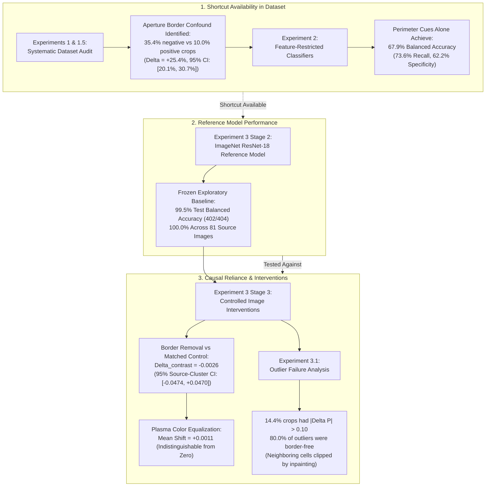
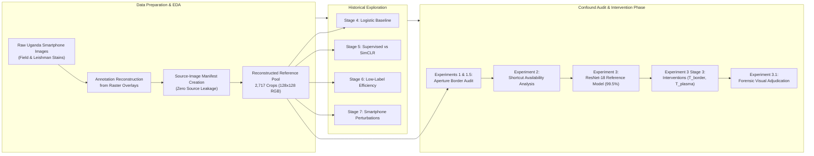
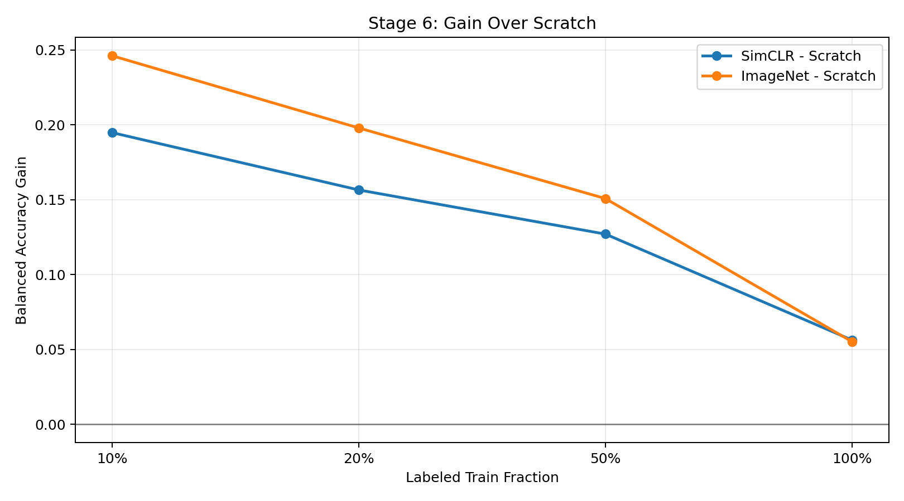
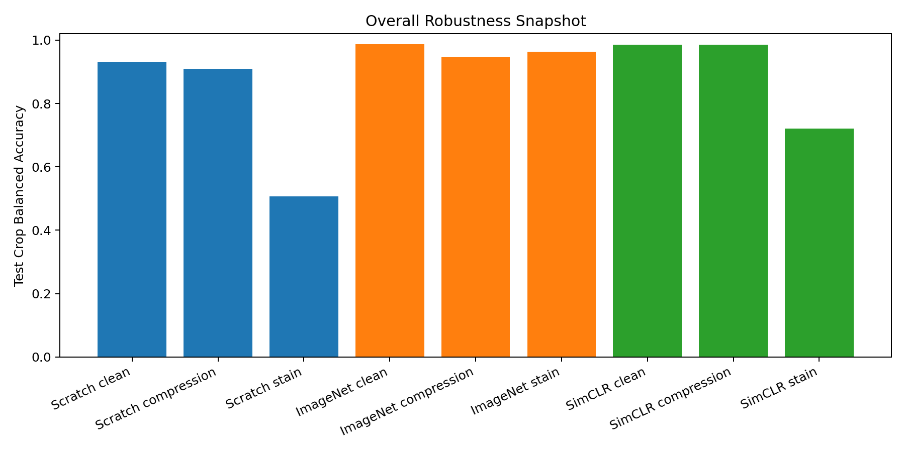
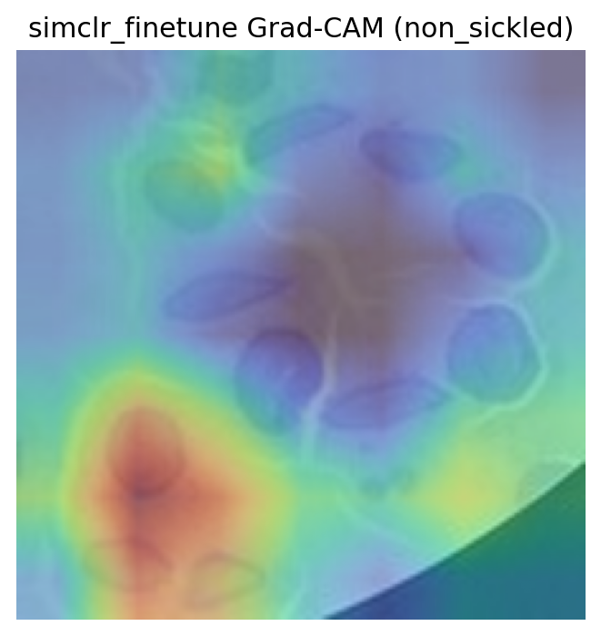
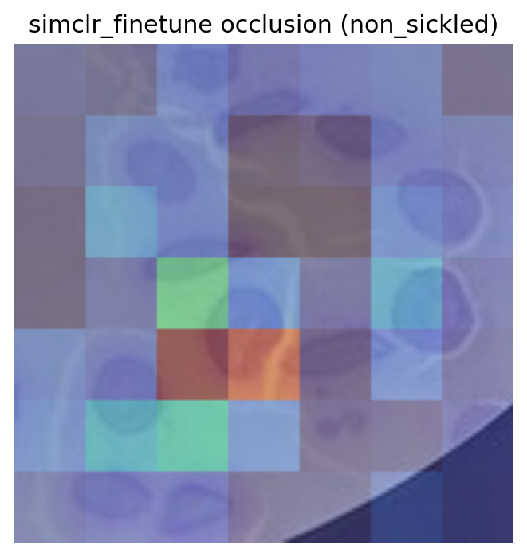

# Shortcut Availability Versus Model Sensitivity: An Exploratory Audit of Smartphone Sickle-Cell Microscopy Classification

[](https://www.python.org/)
[](https://pytorch.org/)
[]()
[]()
[]()

> **Lead Researcher**: Shubhdeep Das  
> **Technical Assistant**: Antigravity AI Coding Assistant  
> **Repository**: [`https://github.com/Shubhdeepdsa/sickel_cell_ssl`](https://github.com/Shubhdeepdsa/sickel_cell_ssl)  
> **Primary Manuscript**: [**`RESEARCH_MANUSCRIPT.md`**](file:///Users/shubhdeepdas/Documents/Code/Research_Nagercoil_Projects/sickel_cell_ssl/RESEARCH_MANUSCRIPT.md)  
> **Active Branch**: `main` (synchronized with `experiment-3-reference-model`)  

---

## Table of Contents
1. [Executive Summary & Core Scientific Contribution](#1-executive-summary--core-scientific-contribution)
2. [End-to-End Pipeline Architecture](#2-end-to-end-pipeline-architecture)
3. [Cohort Assembly & Exploratory Data Analysis (EDA)](#3-cohort-assembly--exploratory-data-analysis-eda)
4. [Discovery of the Aperture-Border Confound (Experiments 1 & 1.5)](#4-discovery-of-the-aperture-border-confound-experiments-1--15)
5. [Shortcut Availability Analysis (Experiment 2)](#5-shortcut-availability-analysis-experiment-2)
6. [Historical Baseline & Representation Learning Benchmark (Stages 4–7)](#6-historical-baseline--representation-learning-benchmark-stages-47)
7. [Reference Model Training & Baseline Quality Gate (Experiment 3 Stage 2)](#7-reference-model-training--baseline-quality-gate-experiment-3-stage-2)
8. [Controlled Artifact Interventions & Uncertainty Bounds (Experiment 3 Stage 3)](#8-controlled-artifact-interventions--uncertainty-bounds-experiment-3-stage-3)
9. [Forensic Failure Analysis & Adjudicated Visual Taxonomy (Experiment 3.1)](#9-forensic-failure-analysis--adjudicated-visual-taxonomy-experiment-31)
10. [Integrated Scientific Discussion & Methodological Boundaries](#10-integrated-scientific-discussion--methodological-boundaries)
11. [Step-by-Step Reproduction Guide](#11-step-by-step-reproduction-guide)
12. [Data Protection, Governance & Public Release Roadmap](#12-data-protection-governance--public-release-roadmap)

---

## 1. Executive Summary & Core Scientific Contribution

Automated classification of sickle-cell erythrocyte morphology from smartphone-mounted optical microscopy holds promise for expanding diagnostic screening in low-resource clinics. However, computer vision models applied to medical imagery are notoriously prone to *shortcut learning*—exploiting non-biological imaging artifacts (such as illumination vignetting or slide staining cues) that happen to correlate with diagnostic labels in a specific dataset.

Earlier iterations of this project achieved remarkable test accuracies exceeding 98–99% using convolutional backbones and self-supervised SimCLR representations. To evaluate whether these scores reflected true cellular morphology or unintended imaging shortcuts, we conducted an end-to-end experimental audit.

### The Central Three-Part Scientific Finding



The investigation separates three questions often conflated in clinical AI research:
1. **Does the dataset contain an unintended shortcut?**  
   **Yes.** Non-sickled crops disproportionately sample peripheral slide coordinates, containing dark microscope aperture borders in **35.4%** of crops compared to only **10.0%** of sickled crops.
2. **Can a classifier exploit that shortcut?**  
   **Yes.** Restricted-feature classifiers trained strictly on the outer 15% crop margin achieve **67.9% balanced accuracy**, well above the 50% random reference level, without examining central cellular morphology.
3. **Did the high-performing reference model depend on that shortcut?**  
   **The interventions did not establish substantial differential dependence on the tested aperture border on average.** Removing borders from border-bearing crops produced a mean probability shift ($+0.045$) virtually identical to matched control edits on clean crops ($+0.047$), with a net contrast of $\Delta_{\text{contrast}} = -0.0026$ (95% CI: $[-0.0474, +0.0470]$). However, individual predictions exhibited meaningful vulnerability to general peripheral image modifications (14.4% of negatives with $|\Delta P| > 0.10$, predominantly due to peripheral cell clipping).

> [!IMPORTANT]
> **Core Conceptual Contribution**:  
> A predictive shortcut can exist in a dataset without being essential to every deep neural network trained on that dataset. Demonstrating that a shortcut is *available* does not prove that a high-performing model *relies* on it. Conversely, limited sensitivity to a specific border intervention does not prove exclusive reliance on biological morphology, as other unmeasured acquisition characteristics and contextual features remain untested.

---

## 2. End-to-End Pipeline Architecture

The complete codebase implements an end-to-end research pipeline, from raw smartphone microscopy ingestion to rigorous causal intervention testing:



---

## 3. Cohort Assembly & Exploratory Data Analysis (EDA)

### 3.1 Clinical Dataset Origin
The experiments utilize the **Uganda Smartphone Microscopy Sickle Cell Dataset**:
- **Curators**: Prof. Florence Tushabe, Samuel Mwesige, Vicent Kasule, David Areu, Philip Mutabazi, Emily Nsimire, Sarah Cheptoek Musani, and Emmanuel Othieno (Soroti University, Uganda).
- **Source**: [Kaggle - florencetushabe/sickle-cell-disease-dataset](https://www.kaggle.com/datasets/florencetushabe/sickle-cell-disease-dataset).
- **Clinical Cohort**: Peripheral blood smears collected from Kumi Hospital, Soroti Regional Referral Hospital, and Soroti University in eastern Uganda. Samples were prepared with Field and Leishman stains and captured using consumer smartphones mounted onto standard compound light microscopes.

### 3.2 Automated Annotation Recovery
Because the primary dataset provided positive sickled labels as red raster bounding-box overlays embedded into full-resolution images, we developed a paired difference-image recovery script (`eda.py`). By matching each labeled image (`datasets/Positive/Labelled/`) to its unlabelled counterpart (`datasets/Positive/Unlabelled/`), the script recovered exact bounding coordinates without manual re-annotation.

### 3.3 Heuristic Non-Sickled Candidate Generation (Pool B)
Unlabelled negative control fields (`datasets/Negative/Clear/`) contain thousands of normal biconcave erythrocytes. Connected components were filtered by luminance and saturation to extract candidate non-sickled crops:

<div align="center">
  
  <p><em>Figure 1. Contact sheet of candidate non-sickled erythrocyte crops (Pool B) extracted via connected-component filtering.</em></p>
</div>

---

## 4. Discovery of the Aperture-Border Confound (Experiments 1 & 1.5)

During data auditing, visual inspection revealed that crops extracted from negative slides frequently contained dark circular arcs along their perimeters. In Experiments 1 and 1.5, we applied an automated edge-luminance annular gradient detector across all 2,717 reconstructed crops.

### The Macroscopic Asymmetry
- **Pool A (Sickled Crops)**: **10.0%** (125 of 1,249 crops flagged).
- **Pool B (Non-Sickled Crops)**: **35.4%** (519 of 1,468 crops flagged).
- **Statistical Significance**: A systematic difference of **25.4 percentage points** (95% source-cluster bootstrap CI: $[20.1\%, 30.7\%]$).

Negative candidate generation disproportionately extracted crops from peripheral slide areas adjacent to the microscope eyepiece field stop. Consequently, an algorithm could theoretically distinguish negative from positive crops merely by detecting this dark boundary.

---

## 5. Shortcut Availability Analysis (Experiment 2)

Experiment 2 tested whether shallow classifiers could exploit these peripheral non-morphological cues to predict class labels without examining central cellular morphology:

| Evaluation Tier | Feature Description | Model & Regularization | Test Balanced Accuracy | 95% Source-Cluster CI | Sickled Recall (TPR) | Non-Sickled Spec (TNR) |
|---|---|---|:---:|:---:|:---:|:---:|
| **Tier 1: Border Flag** | Single binary border indicator | Decision stump ($th = 0.50$) | **61.9%** | [56.1%, 67.8%] | 89.6% | 34.2% |
| **Tier 2: Perimeter Features** | 12 edge statistics (RGB, luma, gradients) | Regularized Logistic ($C=1.0, th^*=0.51$) | **67.9%** | [60.7%, 75.1%] | **73.6%** (134/182) | **62.2%** (138/222) |
| **Tier 3: Background Plasma** | Masked extracellular plasma statistics | Regularized Logistic ($C=10.0, th^*=0.55$) | **64.1%** | [57.8%, 70.3%] | 36.8% | 91.4% |

> [!NOTE]
> **Perimeter Feature Content**:
> As documented in Experiment 2, the outer 15% margin captures both microscope aperture vignetting and peripheral erythrocyte packing geometry (neighboring cells grazing the margin). Thus, Tier 2 demonstrates that peripheral image information is highly predictive, but that information is not exclusively non-morphological.

---

## 6. Historical Baseline & Representation Learning Benchmark (Stages 4–7)

Before the artifact audit was conducted, the project completed a multi-stage investigation comparing classical models, supervised ResNet-18 training from scratch, ImageNet transfer learning, and in-domain self-supervised SimCLR pretraining.

### 6.1 Classical Baseline (Stage 4)
A logistic regression model trained on flattened crop pixels served as the minimal sanity baseline:

<div align="center">
  
  
  <p><em>Figure 2. Stage 4 classical baseline test performance: confusion matrix (left) and ROC curve (right, AUC = 0.957).</em></p>
</div>

### 6.2 Full-Label Representation Learning Comparison (Stage 5)
Comparing deep architectures under full training labels (1,931 crops):

<div align="center">
  
  <p><em>Figure 3. Stage 5 full-label comparison across Supervised Scratch, In-Domain SimCLR, and ImageNet Pretrained ResNet-18.</em></p>
</div>

| Model Family | Initialization | Test Balanced Accuracy | Test Raw Accuracy | Test ROC AUC |
|---|---|:---:|:---:|:---:|
| **Classical Logistic** | Scikit-Learn L2 | 87.8% | 88.1% | 0.957 |
| **ResNet-18 (Scratch)** | Random initialization | 93.1% | 93.3% | 0.981 |
| **ResNet-18 (SimCLR)** | In-domain contrastive pretraining | 98.5% | 98.5% | 0.998 |
| **ResNet-18 (ImageNet)** | Torchvision ImageNet-1K | **98.6%** | **98.8%** | **0.999** |

### 6.3 Low-Label Efficiency Sweeps (Stage 6)
To evaluate label efficiency, models were trained on 10%, 20%, 50%, and 100% of labeled source images:

<div align="center">
  
  
  <p><em>Figure 4. Stage 6 label-efficiency sweeps: test balanced accuracy (left) and SimCLR gain over training from scratch (right).</em></p>
</div>

<div align="center">
  
  <p><em>Figure 5. Performance heatmap across label fractions and representation pretraining schemes.</em></p>
</div>

**Key Finding**: In-domain SimCLR consistently outperformed training from scratch, with the performance gap expanding as labeled data decreased (+5.4% at 100% labels $\to$ **+19.5% at 10% labels**). However, ImageNet fine-tuning remained the strongest overall baseline across all label regimes.

### 6.4 Smartphone Perturbation Robustness (Stage 7)
Models were stress-tested against realistic smartphone microscopy degradations (Gaussian blur, luminance shifts, JPEG compression, and chromatic stain variations):

<div align="center">
  
  
  <p><em>Figure 6. Stage 7 robustness evaluation: performance drop from clean (left) and perturbation degradation curves (right).</em></p>
</div>

<div align="center">
  
  <p><em>Figure 7. Comprehensive robustness radar across all tested smartphone imaging corruptions.</em></p>
</div>

### 6.5 Initial Explainability (XAI) Sensitivity
Early attribution analysis using Grad-CAM and occlusion sensitivity revealed that the RGB SimCLR model exhibited extreme sensitivity to color perturbations:

<div align="center">
  
  
  
  <p><em>Figure 8. Attribution failure case: Grad-CAM hotspot extending into background (left), occlusion sensitivity (center), and complete prediction reversal under mild stain alteration (right).</em></p>
</div>

---

## 7. Reference Model Training & Baseline Quality Gate (Experiment 3 Stage 2)

To evaluate whether a deep network relies on the aperture-border shortcut discovered in Experiments 1 and 2, we trained an ImageNet-pretrained ResNet-18 reference model under a **frozen exploratory protocol**:

```
Model Identity:   Experiment 3 — ImageNet ResNet-18 Reference Model
Architecture:     ResNet-18 (Torchvision ResNet18_Weights.DEFAULT)
Hardware Backend: Apple Silicon M4 MPS (PyTorch 2.14.1)
Checkpoint Hash:  83cd725076f60899bea0dfe4b7bbaa729ff82a60293b4e799d3082a6ae0419bb
Checkpoint File:  experiment_3_reference_outputs/best_model.pt (Epoch 13)
```

### Baseline Performance on Unchanged Test Partition
Selected strictly by peak validation balanced accuracy (**99.8%**, Epoch 13), the frozen model was evaluated once on the unchanged test partition ($N = 404$ crops):

| Evaluation Level | Sample Size | Balanced Accuracy | Raw Accuracy | Sickled Recall (TPR) | Non-Sickled Spec (TNR) | ROC AUC |
|---|---:|---:|---:|---:|---:|---:|
| **Crop Level (Standard $th=0.50$)** | 404 crops | **99.5%** | 99.5% | 99.5% (181/182) | 99.5% (221/222) | 0.9997 |
| **Source-Image Level (Cluster Mean)** | 81 source files | **100.0%** | 100.0% | 100.0% (59/59) | 100.0% (22/22) | 1.0000 |

With test balanced accuracy exceeding the pre-registered quality gate ($\ge 75.0\%$), the model was deemed eligible for controlled causal interventions.

---

## 8. Controlled Artifact Interventions & Uncertainty Bounds (Experiment 3 Stage 3)

### 8.1 Subgroup Stratification on Natural Crops
We stratified natural, unmodified test crops by class and border presence:

| Subgroup Stratum | Number of Crops | Reference Model Accuracy | Mean $P(\text{Sickled})$ | Std Dev |
|---|---:|---:|---:|---:|
| **Stratum 1: Sickled (Clean / No Border)** | 168 | **99.4%** | 0.994 | 0.075 |
| **Stratum 2: Sickled (Border Present)** | 14 | **100.0%** | 0.996 | 0.012 |
| **Stratum 3: Non-Sickled (Clean / No Border)** | 152 | **99.3%** | 0.013 | 0.063 |
| **Stratum 4: Non-Sickled (Border Present)** | 70 | **100.0%** | 0.003 | 0.023 |

**Key Finding**: On the 152 natural non-sickled crops with **zero detected aperture border**, the model achieved **99.3% accuracy** (151/152 correct) with a mean predicted sickled probability of only **0.013**. The dark border is not required for the classifier to recognize non-sickled cells.

### 8.2 Controlled Perimeter Inpainting ($T_{\text{border}}$ vs $T_{\text{control}}$)
We replaced the outer 15% margin (19 pixels) with local background color using a Gaussian-smoothed edge blend, comparing border-bearing non-sickled crops ($T_{\text{border}}$) against an identical edit on clean non-sickled crops ($T_{\text{control}}$):

$$\Delta_{\text{contrast}} = \mathbb{E}[\Delta P \mid \text{Border}] - \mathbb{E}[\Delta P \mid \text{Clean}] = \mathbf{-0.0026}$$
$$95\% \text{ Source-Cluster Bootstrap CI} = \mathbf{[-0.0474, +0.0470]}$$

$$\Delta_{|\text{contrast}|} = \mathbb{E}[|\Delta P| \mid \text{Border}] - \mathbb{E}[|\Delta P| \mid \text{Clean}] = \mathbf{-0.0173}$$
$$95\% \text{ Source-Cluster Bootstrap CI} = \mathbf{[-0.0640, +0.0339]}$$

> [!NOTE]
> **Interpretation as an Uncertainty Bound**:
> The estimated contrast is near zero and the 95% bootstrap interval spans zero, demonstrating that the study did not detect a clear differential response between the two groups. However, because the interval admits modest differences of up to $\sim \pm 0.05$, this represents an **absence of detected difference rather than proven mathematical equivalence**.

### 8.3 Background Plasma Equalization
Multiplicatively rescaling RGB channels across all test crops to match the empirical training-set median background (`(216.13, 217.12, 209.12)`) shifted predictions by a negligible $+0.0011$ (mean $|\Delta P| = 0.0048$, 95% CI: $[-0.001, +0.004]$).

---

## 9. Forensic Failure Analysis & Adjudicated Visual Taxonomy (Experiment 3.1)

While the signed average shift was modest (+0.045), examining absolute probability shifts ($|\Delta P|$) revealed substantial individual sensitivity:
- **Median $|\Delta P|$**: 0.0000 (over 75% of crops had $|\Delta P| \le 0.0005$).
- **Crops with $|\Delta P| > 0.10$**: **14.4%** (32 / 222 non-sickled crops).
  - Border-Bearing Negatives: **14.3%** (10 / 70)
  - Border-Free Negatives: **14.5%** (22 / 152)

Large prediction shifts occurred at virtually identical rates regardless of whether the original crop contained an aperture border.

### Adjudicated Visual Review of Top 20 Outliers
Each of the 20 largest prediction shifts was individually reviewed and logged in [`outlier_visual_audit_adjudication.csv`](file:///Users/shubhdeepdas/Documents/Code/Research_Nagercoil_Projects/sickel_cell_ssl/experiment_3_reference_outputs/outlier_visual_audit_adjudication.csv):

| Adjudicated Category in CSV | Outlier Count | Proportion | Crops Affected | Empirical Visual Observations |
|---|---:|---:|---|---|
| **Peripheral Cell Clipping** | 9 | **45.0%** | `pool_b_89_cand04`, `128_cand04`, `37_cand09`, `66_cand09`, `108_cand02`, `133_cand01`, `108_cand04`, `108_cand12`, `49_cand10` | Neighboring erythrocytes graze the 15% outer margin. Inpainting severs adjacent cell bodies, creating asymmetric contours that mimic abnormal cell morphology. |
| **Aperture Border Removal** | 4 | **20.0%** | `pool_b_96_cand07`, `147_cand01`, `96_cand10`, `92_cand11` | Genuine dark aperture boundary erased and replaced with plasma canvas, shifting $P(\text{Sickled})$ upward ($+0.28$ to $+0.96$). |
| **Threshold Boundary Cases Clarified** | 3 | **15.0%** | `pool_b_37_cand06`, `pool_b_56_cand12`, `pool_b_37_cand03` | Borderline predictions ($P \approx 0.28 - 0.51$) resolved to confident non-sickled ($P \approx 0.002 - 0.28$) when peripheral noise and edge shadows were erased. |
| **Empty / Faint Plasma Background Crops** | 2 | **10.0%** | `pool_b_116_cand11`, `pool_b_122_cand04` | Crops contain virtually no dark cell body (<1% dark pixels); uniform inpainting canvas introduces artificial edge gradients on flat plasma. |
| **Subthreshold Border and Crowding** | 1 | **5.0%** | `pool_b_108_cand03` | Peripheral field contains subthreshold dark edge material and dense RBC crowding, both erased by canvas. |
| **Faint Crop Boundary Erasure** | 1 | **5.0%** | `pool_a_399_box1` | Faint sickled crop with subtle boundary gradient; margin inpainting blended the anchoring edge contour. |

> [!IMPORTANT]
> **Adjudicated Outlier Distribution**: Exactly **16 of the top 20 outliers (80.0%) were border-free crops (`border = 0`)**. This confirms that large prediction changes were predominantly driven by general peripheral image modifications (especially adjacent cell truncation and synthetic blend boundaries) rather than isolated aperture border reliance.

---

## 10. Integrated Scientific Discussion & Methodological Boundaries

### 10.1 Decoupling Shortcut Availability from Model Reliance
The primary scientific contribution of this study is the empirical separation of **shortcut availability** from **demonstrated model reliance**:
1. Experiments 1 and 2 proved that an aperture-border shortcut was strongly associated with class labels and sufficient for shallow models to predict labels well above chance (67.9% balanced accuracy).
2. Experiments 3 and 3.1 demonstrated that a high-performing ResNet-18 reference model showed no clear additional average sensitivity to border removal relative to control edits ($\Delta_{\text{contrast}} = -0.0026$), while maintaining 99.3% accuracy on border-free crops.

A predictive shortcut can exist in a dataset without being essential to every deep model trained on that dataset.

### 10.2 Methodological Boundaries & Limitations
- **No Proof of Exclusive Morphology Learning**: Showing limited sensitivity to aperture borders and color shifts does not prove that the model relies exclusively on biological sickle-cell morphology. Other untested acquisition covariates, such as optical aberrations, slide preparation artifacts, or subtle contextual patterns, could remain influential.
- **Single Architecture Scope**: We evaluated one newly trained reference model (ImageNet-initialized ResNet-18). These experiments do not establish whether self-supervised models (e.g., SimCLR) or models trained strictly from scratch exhibit the same level of intervention sensitivity.
- **Source-Image Independence vs Clinical Generalization**: Partitioning by source-image prevents intra-image crop leakage, but does not guarantee generalization to independent clinics, staining protocols, or patient demographics.

---

## 11. Step-by-Step Reproduction Guide

### Environment Setup
The codebase uses [`uv`](https://github.com/astral-sh/uv) and supports Python 3.12+ on macOS (Apple Silicon MPS) and Linux (CUDA):

```bash
# 1. Clone the repository
git clone https://github.com/Shubhdeepdsa/sickel_cell_ssl.git
cd sickel_cell_ssl

# 2. Create virtual environment using Python 3.12
uv venv --python 3.12 .venv
source .venv/bin/activate

# 3. Install dependencies
uv pip install torch torchvision numpy pillow
```

### Reproducing the Experiments

```bash
# Phase 1: Reconstruct the physical reference dataset (2,717 crops, 128x128 RGB)
python reconstruct_reference_dataset.py

# Phase 2: Run Confound Availability Analysis (Experiment 2)
python experiment_2_confound_investigation.py

# Phase 3: Run Stage 2 Pre-flight smoke test (zero test leakage)
python train_experiment3_reference_model.py --smoke-test

# Phase 4: Train Reference ResNet-18 Model (20 epochs on Apple Silicon MPS / CUDA)
python train_experiment3_reference_model.py --epochs 20 --batch-size 32 --lr 1e-4 --seed 42

# Phase 5: Execute Controlled Interventions (T_border, T_control, T_plasma)
python evaluate_experiment3_interventions.py

# Phase 6: Execute Forensic Failure Analysis & Outlier Visual Adjudication
python run_experiment3_1_failure_analysis.py
```

### Deterministic Artifact Hashes
| Artifact File | Description | SHA-256 Checksum |
|---|---|---|
| `crop_outputs/pool_a_labeled_sickled_manifest.csv` | Labeled sickled manifest (1,249 crops) | `1e849ffd8350578e192948e1d0907699491c228ba1de6a96ff234f00d7c81d27` |
| `crop_outputs/pool_b_labeled_non_sickled_manifest.csv` | Labeled non-sickled manifest (1,468 crops) | `61fab3f079a4d9650f51f1646b364499275f3d73c255859b971f9c95bc6cf9eb` |
| `experiment_3_reference_outputs/best_model.pt` | Reference ResNet-18 frozen weights | `83cd725076f60899bea0dfe4b7bbaa729ff82a60293b4e799d3082a6ae0419bb` |

---

## 12. Data Protection, Governance & Public Release Roadmap

- **Current Repository Status**: The code, manifests, and documentation are maintained in a **private research repository**.
- **Data Protection Compliance**: Raw microscopy slides (`datasets/`) and crop image files (`crop_outputs/**/*.jpg`) are excluded from Git tracking via `.gitignore`.
- **Pre-Publication Image Audit**: In addition to untracking new outlier panels, an audit ([`MICROSCOPY_IMAGE_TRACKING_AUDIT.md`](file:///Users/shubhdeepdas/Documents/Code/Research_Nagercoil_Projects/sickel_cell_ssl/MICROSCOPY_IMAGE_TRACKING_AUDIT.md)) identified 137 historical microscopy-derived visualization files currently tracked in the Git tree and prior commit history.
- **Public Release Roadmap**: Before transitioning the repository to public access, either:
  1. A formal redistribution-rights review must confirm permission to host derived crop visualizations under the original Soroti University Kaggle license; or
  2. A Git history prune (via `git-filter-repo` or BFG) must remove historical image binaries from prior commits while preserving all commit logs, source scripts, manifests, and technical reports.

---

## Primary Research Reports
- **Complete Technical Manuscript**: [`RESEARCH_MANUSCRIPT.md`](file:///Users/shubhdeepdas/Documents/Code/Research_Nagercoil_Projects/sickel_cell_ssl/RESEARCH_MANUSCRIPT.md)
- **Reference Model Provenance & Training Report**: [`experiment_3_reference_outputs/EXPERIMENT_3_REFERENCE_MODEL_REPORT.md`](file:///Users/shubhdeepdas/Documents/Code/Research_Nagercoil_Projects/sickel_cell_ssl/experiment_3_reference_outputs/EXPERIMENT_3_REFERENCE_MODEL_REPORT.md)
- **Controlled Intervention Report**: [`experiment_3_reference_outputs/EXPERIMENT_3_INTERVENTION_REPORT.md`](file:///Users/shubhdeepdas/Documents/Code/Research_Nagercoil_Projects/sickel_cell_ssl/experiment_3_reference_outputs/EXPERIMENT_3_INTERVENTION_REPORT.md)
- **Forensic Failure Analysis & Audit**: [`experiment_3_reference_outputs/EXPERIMENT_3_1_AUDIT_REPORT.md`](file:///Users/shubhdeepdas/Documents/Code/Research_Nagercoil_Projects/sickel_cell_ssl/experiment_3_reference_outputs/EXPERIMENT_3_1_AUDIT_REPORT.md)
- **Adjudicated Outlier Review CSV**: [`experiment_3_reference_outputs/outlier_visual_audit_adjudication.csv`](file:///Users/shubhdeepdas/Documents/Code/Research_Nagercoil_Projects/sickel_cell_ssl/experiment_3_reference_outputs/outlier_visual_audit_adjudication.csv)
- **Dataset Specification**: [`crop_outputs/REFERENCE_DATASET_SPECIFICATION.md`](file:///Users/shubhdeepdas/Documents/Code/Research_Nagercoil_Projects/sickel_cell_ssl/crop_outputs/REFERENCE_DATASET_SPECIFICATION.md)
- **Microscopy Tracking Audit**: [`MICROSCOPY_IMAGE_TRACKING_AUDIT.md`](file:///Users/shubhdeepdas/Documents/Code/Research_Nagercoil_Projects/sickel_cell_ssl/MICROSCOPY_IMAGE_TRACKING_AUDIT.md)
